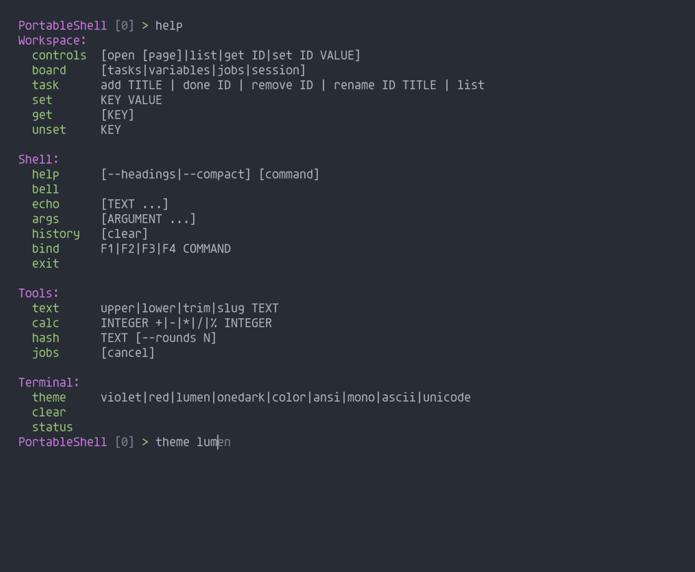
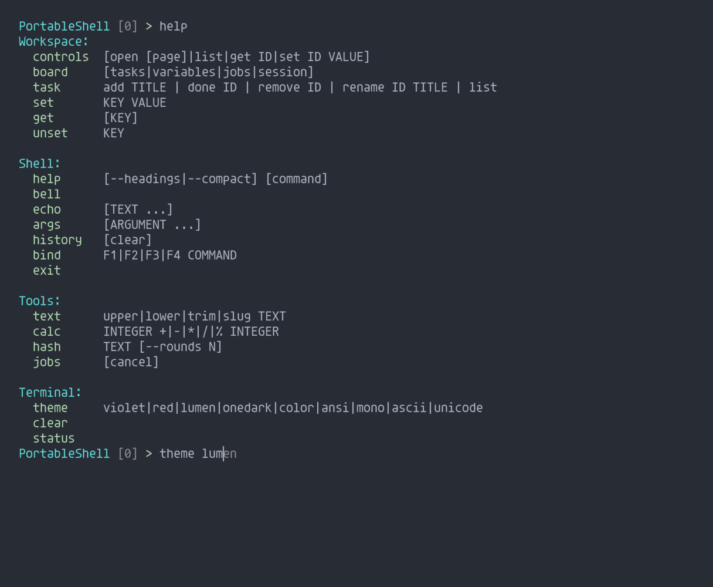

# Editor feedback — 0.14.0

Default interactive behavior:

- BEL on invalid cursor/history movement, unmatched Tab and input overflow; `bell`
  or Ctrl+G provides an explicit check. `--no-bell` / `PS_NO_BELL` mutes it.
- Ghost text uses the newest matching history entry, then the same command and
  argument providers as Tab. No special build flag is required. → / End accepts
  the displayed candidate at the end of input; Enter executes only accepted/typed
  input. End inside a line moves to its end first.
- `--no-suggestions` / `PS_NO_SUGGESTIONS` disables ghost text, retaining Tab.
- `help` / `help --headings` groups commands under headings. `help --compact`
  retains category columns. `help NAME` prints Usage. The public `ps_print_help`
  function also serves the optional original-API adapter.

The donor comparison checked the raw BEL emissions in `LocalLib/Shell.cpp` at
PU850 commit `431104072952f694a35b3a83c19f13fbb098ca5b`, and Ardush's
`SerialConsole/src/portable_console.h`, which delegates editing to
`ps_editor_feed` / `ps_editor_bell`. They emit byte 7; they do not synthesize sound
in the shell. The full C engine lacked equivalent feedback. Its history-only
suggestion path also lacked fresh command suggestions and End acceptance. This
change preserves the existing reusable component editor and donor code.

The Windows adapter now explicitly enables processed console output alongside VT
processing. Telnet/serial still carry BEL as a byte. Terminal sound or visual-bell
preferences remain the receiver's responsibility; automated tests prove bytes,
not that a person heard audio.

## Verification

- Portable and libc x86-64 builds: 10 CTest targets each pass, including actual
  native-host Telnet negotiation, sent keystrokes, Right/End completion, headed
  help, command execution, BEL receipt and muted BEL absence.
- Compact buffers: five targets pass. ASCII-only checks also pass.
- Core tests cover custom providers, quoted suggestions, UTF-8 history, Enter
  without acceptance, overflow bells, retained Tab behavior, batch silence,
  compact help, null categories and untruncated long command names.
- ARM32 cross-build and archive symbol audit pass. This is build evidence,
  not a hardware run. Portable archives have no unresolved runtime dependency.
- The `editor_preview` C fixture captures emitted bytes; the C ANSI replay utility
  renders the pictures below. Agave was resolved to the installed
  `agave-regular-slashed.ttf`; SVG rasterization uses 2× sampling and downsampling.
  A static cursor marks the terminal position from the captured stream.

Reproduce these 96×36 prompt replays with `editor_preview OUTPUT.ansi onedark`
(or `lumen`), compile `tests/ansi_render.c` with `H=36` and `PS_REPLAY_CURSOR`,
then feed it the ANSI capture and an SVG output path. The normal replay target
retains its 96×24 defaults and no cursor overlay.

## Size and memory

Windows x86-64 GCC build, portable primitives: **59,904 bytes** executable;
optional libc build: **83,456 bytes**. Session storage: **30,296 bytes**, up 512
bytes for the exact displayed suggestion cache. Core heap allocations: **zero**.
The minimum command capacity is now 20 to accommodate `bell` without silently
dropping another built-in. Default capacity remains 40; compact capacity is 24.

A fresh native process, after replying `42` to a piped `calc 6 * 7`, sampled
**4,460,544 bytes working set** and **1,372,160 bytes private memory**. These are
Windows process measurements including the transport and OS/runtime footprint,
not core storage requirements or a worst-case peak. Compiler stack reports show
1,520 bytes for `prompt` and 1,952 for its candidate collector on this build;
consumer callbacks and caller stack are additional. No claim of human acceptance
or MCU runtime testing is made.
