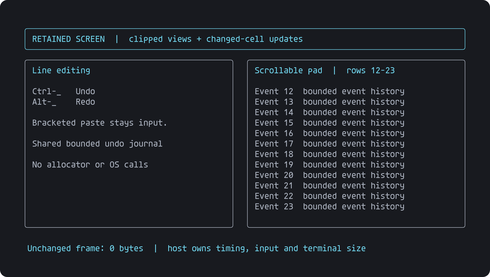
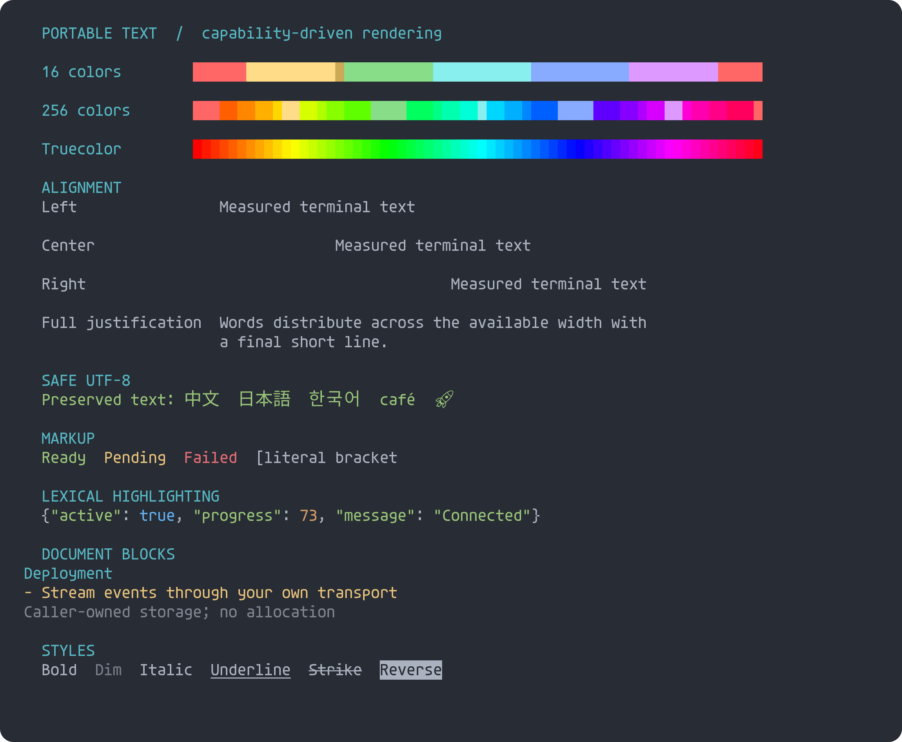
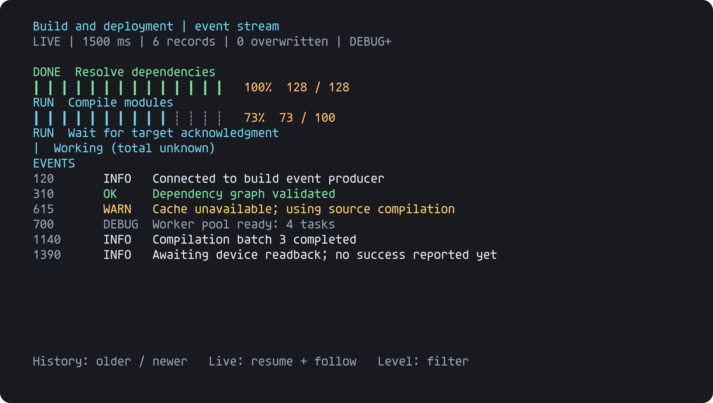
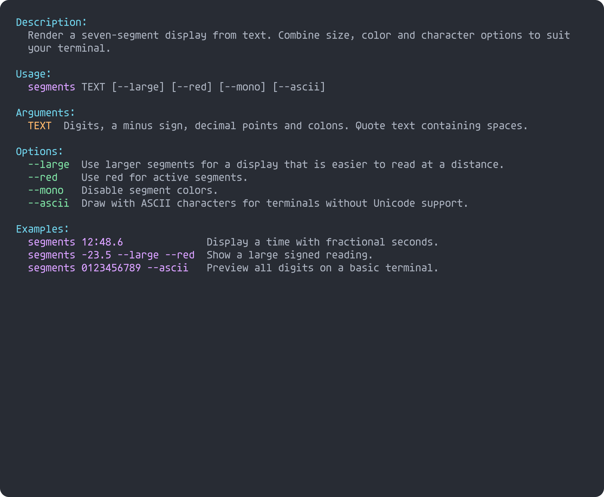
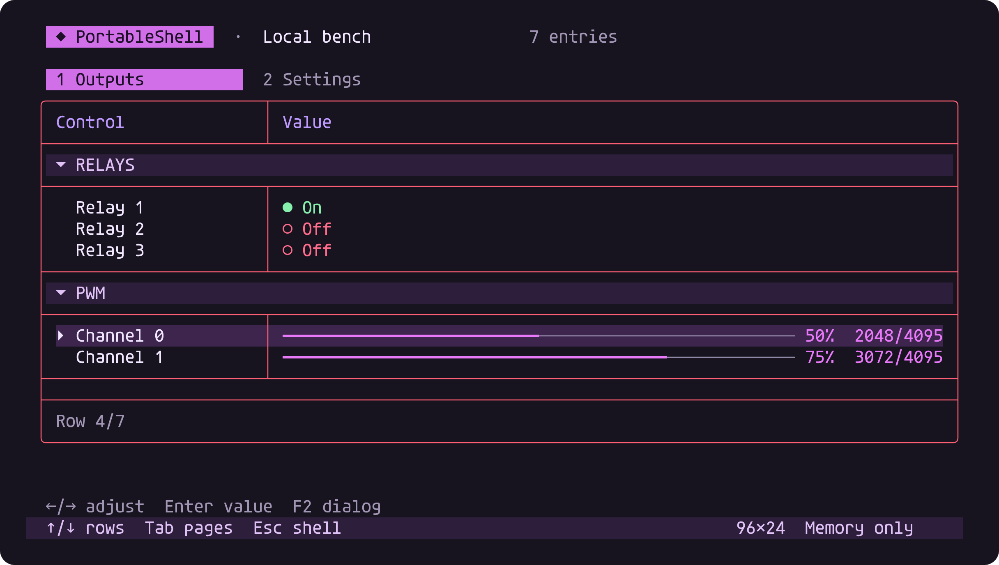
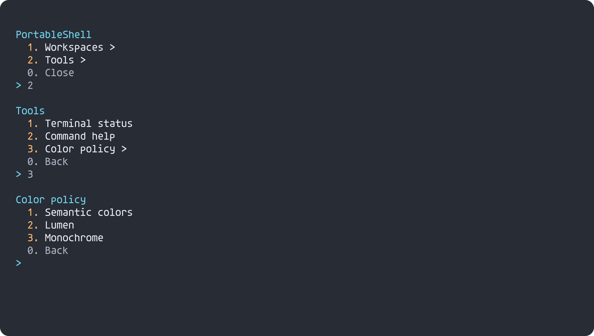
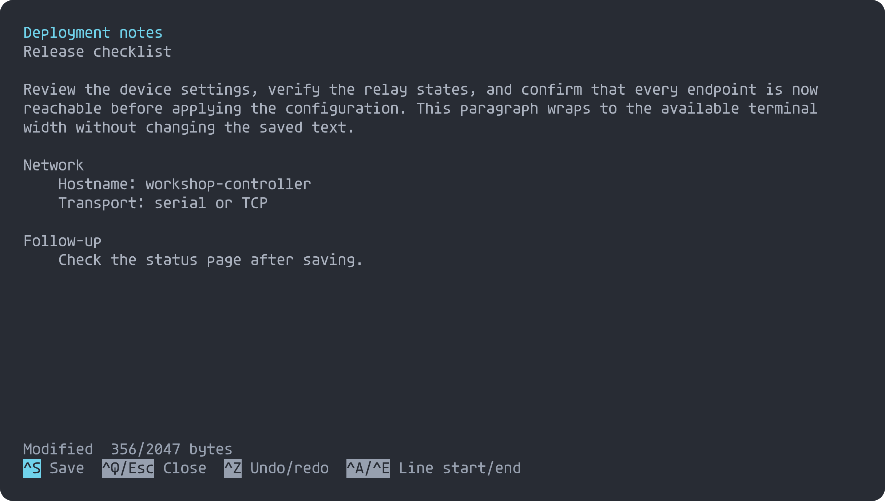
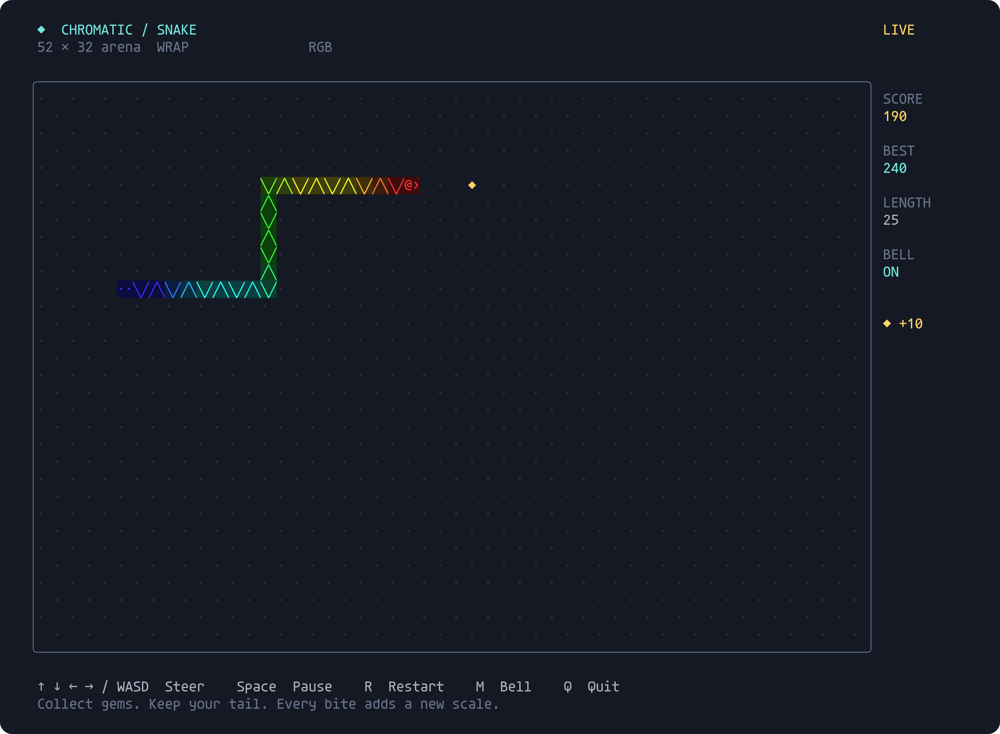

# 🐚 PortableShell

A byte-driven C99 shell and terminal UI toolkit: custom commands, completion,
history, editable tables, numbered menus, and a wrapped text editor. The reusable
core is allocation-free and OS-independent; replaceable C adapters provide native
console, TCP/Telnet, and serial I/O. No third-party runtime is linked into the core.

[📚 Wiki](https://github.com/atomicdeploy/portable-shell/wiki) ·
[🛠️ Builds](https://github.com/atomicdeploy/portable-shell/actions/workflows/build.yml) ·
[🛡️ CodeQL](https://github.com/atomicdeploy/portable-shell/actions/workflows/codeql.yml) ·
[🔐 Security](SECURITY.md)

## Framework and consumer applications

The `portable_shell` library starts with an empty command registry. Consumers supply
commands, help, completion callbacks, application titles and typed settings.
The native demo uses the separate `portable_shell_workbench` composition; its
application commands live under `host/workbench/`, outside the reusable core.
Link one composition, not both. [Registration and migration guide](docs/wiki/Commands.md)
· [Runnable consumer example](examples/consumer_commands.c)

## Terminal interaction

Shared bounded undo/redo, protected bracketed paste, and an opt-in retained screen with clipped windows, scrolling pads and changed-cell repainting. [API and compatibility boundaries](https://github.com/atomicdeploy/portable-shell/wiki/Terminal-interaction).



## Rich text output

Optional color conversion, ANSI styles, UTF-8 text, wrapping and alignment, bounded markup, document blocks and lexical highlighting. [Capabilities and limits](https://github.com/atomicdeploy/portable-shell/wiki/Rich-text).



## Live monitoring and logging

Optional task progress, timestamped severity logs, bounded history, pause/follow and filtering. Includes a stdin event adapter and plain pipeline output. [API and commands](https://github.com/atomicdeploy/portable-shell/wiki/Monitoring). These previews use simulated events rendered by the actual component.



## Filterable lists

Run menu --list for two-line entries, filtering, pagination and contextual help. [List](previews/menu-list.png) · [Filter](previews/menu-filtered.png) · [API](https://github.com/atomicdeploy/portable-shell/wiki/Menus#filterable-list-mode)

## Meter styles and scrolling

Unicode segmented bars and centered value controls share the meter API. [Styles](previews/meters-segmented.png) · [Scrolled table](previews/table-scrolled.png) · [API](https://github.com/atomicdeploy/portable-shell/wiki/Meters)

## Multi-panel controls

Run controls dashboard for simultaneous panels with stepped values, toggles and inline editing. [Dashboard](previews/dashboard.png) · [Inline edit](previews/dashboard-edit.png) · [API](https://github.com/atomicdeploy/portable-shell/wiki/Shell#multi-panel-dashboard)

## Forms

Framed text input, validation messages, radio choices and sequential steps share the existing byte editor. [Validation](previews/form-validation.png) · [Choices](previews/form-choice.png) · [Completed and active steps](previews/form-steps.png) · [API](https://github.com/atomicdeploy/portable-shell/wiki/Shell#framed-forms)

## Reports

Borderless dotted-leader reports support sections, muted annotations and right-aligned values. Run status --report or supply application rows through ps_print_report. [Actual-output preview](previews/report-leaders.png) · [Live session](previews/report-status.png)

## Help



Grouped descriptions, aligned options and examples, width-aware wrapping, and optional metadata. [Command registry](previews/help-registry.png) · [Monochrome](previews/help-plain.png) · [Help API](https://github.com/atomicdeploy/portable-shell/wiki/Shell#contextual-help)

## 🚀 Build and run

With GCC (MinGW-w64 on Windows), CMake and Ninja:

```text
cmake -S . -B build -G Ninja -DCMAKE_BUILD_TYPE=MinSizeRel
cmake --build build
ctest --test-dir build --output-on-failure
build/PortableShell --controls
```

On Windows use `build/PortableShell.exe`. Start without an option for the prompt;
`--menu` opens nested numbered choices and `--edit` opens session notes. Editor
saves are in memory unless the embedding application supplies persistence.

[Getting started](docs/wiki/Getting-started.md) · [Build targets](docs/wiki/Building.md) ·
[Feature flags](docs/wiki/Options.md) · [Embed the core](docs/wiki/Embedding.md)

## 🖼️ Preview



| Numbered menus | Text editor |
| --- | --- |
|  |  |

These are emitted-byte replay fixtures rendered with pinned Agave and antialiasing,
not hardware captures. [Full gallery](docs/wiki/Gallery.md) includes vertical tabs,
inline editing, dialogs, matrix controls, Cyan, One Dark and ASCII examples.
CI regenerates all previews and rejects stale images.

```text
cmake -DMODE=UPDATE -DGENERATOR=Ninja -P tools/rebuild-previews.cmake
```

## 📚 Documentation

Detailed guides live in the [wiki](https://github.com/atomicdeploy/portable-shell/wiki).
Their reviewed source is in [docs/wiki](docs/wiki/Home.md), so documentation remains
available offline and can be checked in pull requests. Edit that source to update
managed wiki pages; existing unmanaged wiki pages are preserved.

- [Shell and keyboard reference](docs/wiki/Shell.md)
- [Tables and workspace](docs/wiki/Workspace.md)
- [Numbered menus](docs/wiki/Menus.md) and [text editor](docs/wiki/Text-editor.md)
- [Telnet and serial](docs/wiki/Transports.md)
- [Host execution, PTYs and remote files](docs/wiki/Host-execution.md)
- [Portability](docs/wiki/Portability.md) and [consumer integration](docs/wiki/Integration.md)
- [CI, security and publishing](docs/wiki/Automation.md)
- [Verification boundaries](docs/wiki/Verification.md)

The default uses semantic colors. Rich UI is the default on every capable target;
smaller builds use explicit feature/capacity flags, not automatic MCU stripping.
Application callbacks own storage, authorization and physical side effects.

[License](LICENSE) · [Preserved source history and attribution](docs/provenance/README.md)

### Callbacks and async work

Commands, input and device providers support callbacks. Optional cooperative jobs add deferred completion, cancellation, deadlines and fair polling; a bounded byte queue supports partial transport writes. Everything uses caller-owned storage. See [async integration](https://github.com/atomicdeploy/portable-shell/wiki/Async) and the [tested command example](examples/async_command.h).

### Chromatic Snake

An optional playable demo with RGB scales, directional eyes, gem food, scoring, pause/restart and standard terminal BEL feedback. Build with PORTABLE_SHELL_SNAKE_EXAMPLE=ON. [Controls and embedding](https://github.com/atomicdeploy/portable-shell/wiki/Snake).



### Local shell language

Local host adapters support native executable launch, concurrent byte pipelines, command chains, conditional execution, file redirection, environment expansion, directory changes and command scripts. The parser stays portable; processes and filesystem operations stay in the host. [Syntax, examples, feature switches and compatibility limits](https://github.com/atomicdeploy/portable-shell/wiki/Local-shell).
