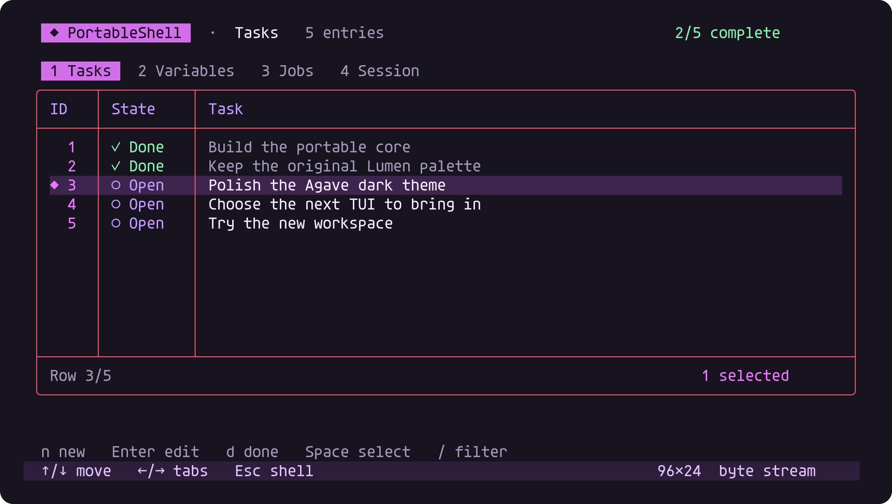
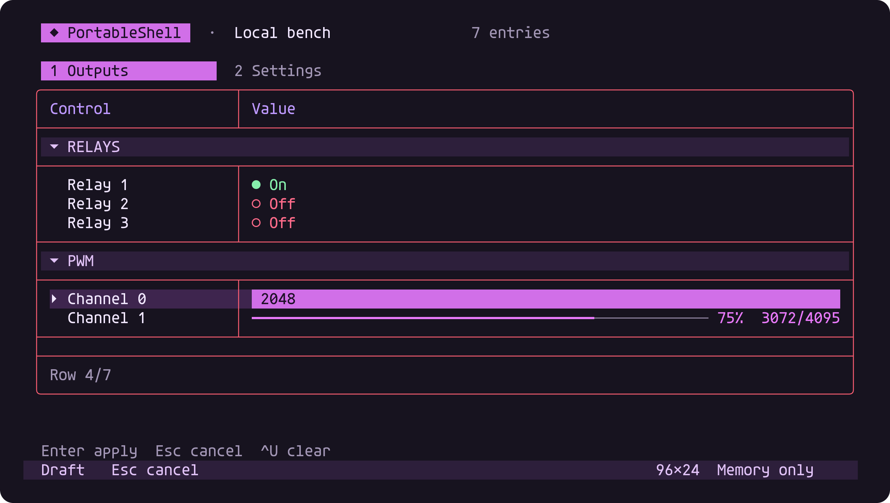
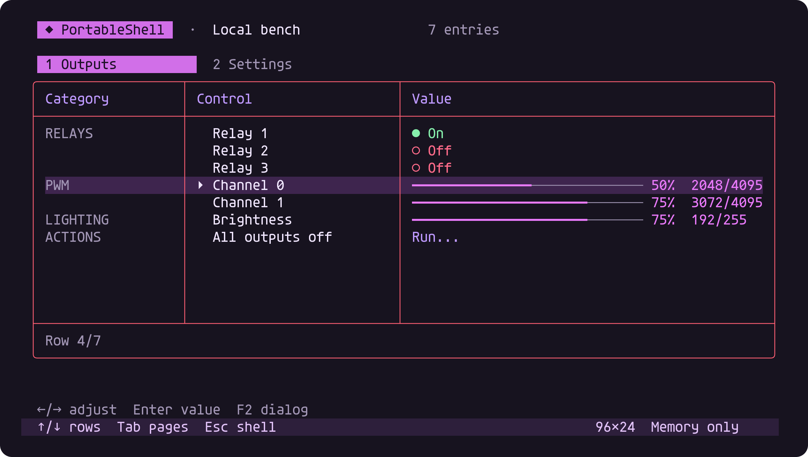
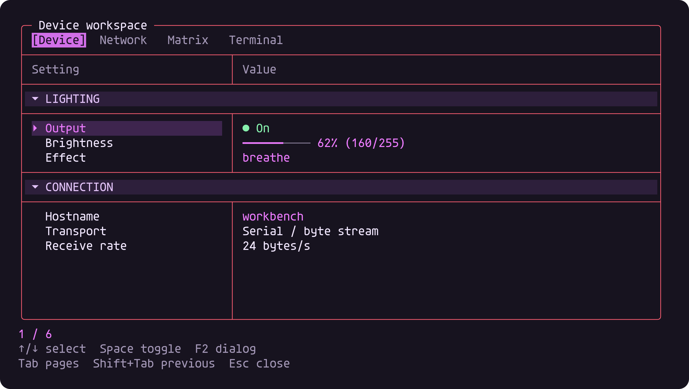
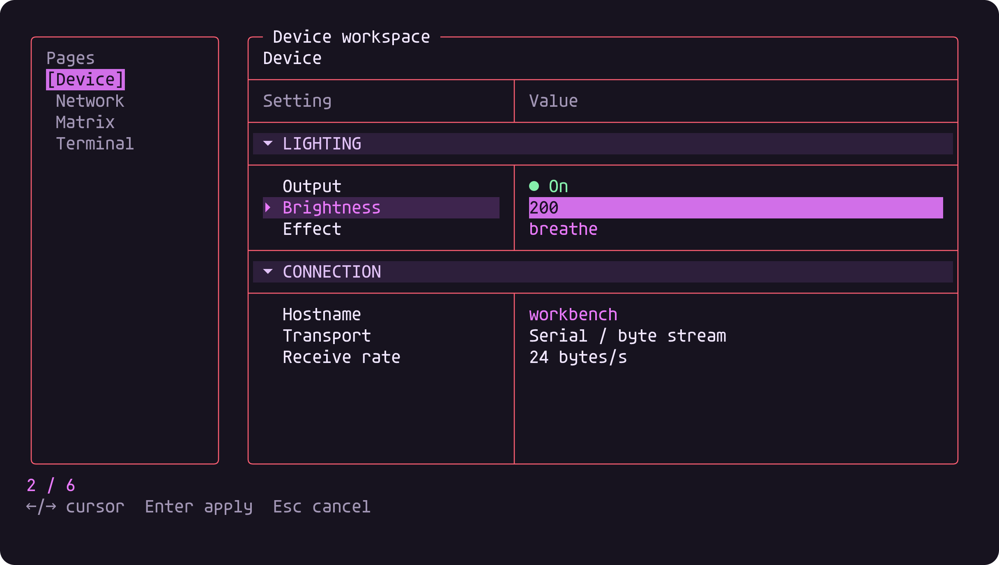
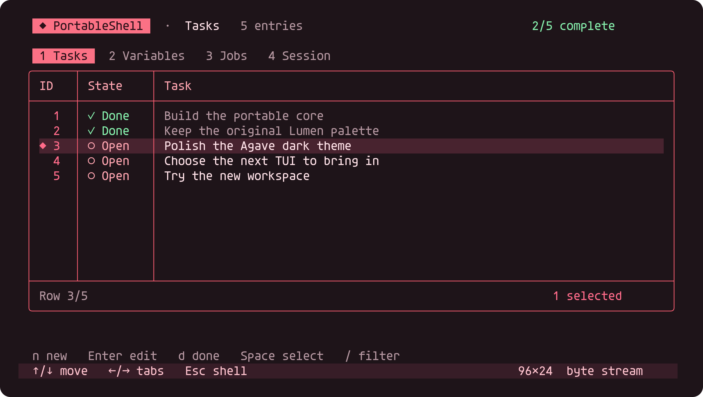
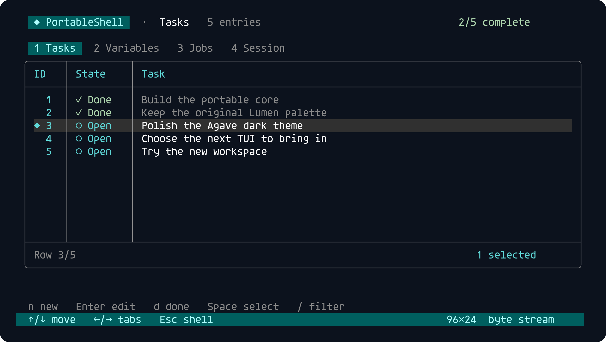
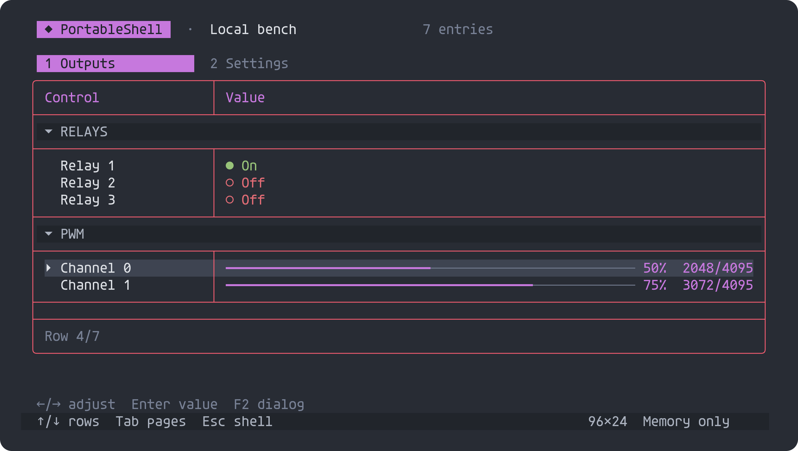

# PortableShell

Canonical repository: https://github.com/atomicdeploy/portable-shell

A byte-driven C99 shell and terminal workbench. The core is written from scratch,
heap-free and independent of the operating system. The default build is freestanding;
an explicit libc backend can use the host's memory/string primitives. Compiler type
headers do not introduce OS calls. See [portability and backends](PORTABILITY.md).

The optional **C host adapters** connect its byte callbacks to a native console,
TCP socket, or serial port. The default Windows GCC host uses only Kernel32 and
Winsock imports, without CRT startup; the optional libc host uses normal CRT startup.
The POSIX adapter uses the platform's system-call wrappers and startup.
No Python, JavaScript, ncurses, readline, or third-party runtime is required.

## Preview gallery

These are **byte-replay captures of the current implementation**, using simulated
fixture data and pinned Agave typography with antialiasing. They are not mockups
or proof of connected hardware. CI rebuilds every image from current source and
rejects stale or missing files.

**Task workspace — Violet**



**Control panel — inline value editing**



| Optional category column (before) | Default collapsible sections (after) |
| --- | --- |
|  |  |

Select a heading with **↑/↓**, then **Enter** or **Space** to toggle it.
**←** collapses and **→** expands. Sections retain their state when switching
pages; inline editing remains in the value cell. [Collapsed example](previews/controls-collapsed.png).
Headings have continuous border rows above and below by default.
[Compact sections](previews/controls-compact.png) omit those extra rows;
see [presentation options](OPTIONS.md#presentation).

| Shared device view | Optional vertical tabs |
| --- | --- |
|  |  |

| Red | Lumen | One Dark |
| --- | --- | --- |
|  |  |  |

More captures: [controls](previews/controls.png), [dialog](previews/dialog.png),
[ASCII](previews/ascii.png), [vertical tabs](previews/device-vertical.png),
[matrix](previews/device-matrix.png), [explicitly reduced view](previews/device-reduced.png).
The reduced view is selected by feature flags; an MCU does not automatically lose features.

Rebuild or check the gallery with GCC, CMake and the pinned host-only image tools:

```text
cmake -DMODE=UPDATE -DGENERATOR=Ninja -P tools/rebuild-previews.cmake
cmake -DGENERATOR=Ninja -P tools/rebuild-previews.cmake
```

The script verifies the downloaded Agave/font-license and rasterizer hashes.
These tools are never linked into PortableShell. Historical captures and source
attribution are preserved separately under [provenance](docs/provenance/README.md).

## Shared firmware components

The reusable editor, Telnet parser, tokenizer, terminal-size probe and
snapshot/action device view are maintained here. Both the full C runtime and
callback editor are available on capable MCUs. Feature flags, not CPU detection,
select smaller builds. The shared device table defaults to rich presentation.
See [integration contracts](CONSUMERS.md), [profiles and options](OPTIONS.md), and
[portability](PORTABILITY.md) for host, AVR, ARM and serial integration boundaries.

## Run

Build from source using the instructions below, then run `build/PortableShell`
(`build/PortableShell.exe` on Windows). Launch with `--controls` for tabs, grouped
tables, toggles, PWM sliders, inline values and confirmation dialogs. The optional
`--device-commands` profile provides device-oriented prompt and command behavior.
Violet is the default theme.

Use **F2** for the workspace, **F1** for the command registry, and **Tab** at the
prompt for completion. The program has no startup tutorial.

```text
build/PortableShell --controls
build/PortableShell --board
build/PortableShell --ascii --no-color
build/PortableShell --history history.txt
build/PortableShell --command "calc 21 * 2"
build/PortableShell -- args "a b" --name=value
build/PortableShell --batch
build/PortableShell --listen 2323
build/PortableShell --serial COM9 --baud 115200
```
`--batch` reads commands from stdin, including a final line without a newline.
Redirected input/output automatically selects batch mode. `--command` accepts one
shell expression; `--` passes the remaining host arguments directly to the command
callback, preserving the host's argument boundaries. Errors return nonzero status;
batch mode's final command determines exit status. `--interactive` explicitly enables
VT output over a byte pipe. `--board` requires an interactive output stream.

History is session-local unless `--history FILE` is supplied. That file is loaded on
startup and replaced on normal exit. Tasks and variables are currently session-local.
No user documents, machine settings, or external processes are modified by commands.

## Workspace

See [profiles, options and current defaults](OPTIONS.md) for the choice matrix
and semantic API naming migration.

The default dark theme uses violet/magenta accents, warm text, mint completion
states and peach values. Switch with `theme red`, `theme violet`, or `theme lumen`
for the preserved original palette. `theme ansi` selects the 256-color fallback;
`theme mono` disables color and `theme ascii` substitutes ASCII borders and hints.
Unicode mode uses actual ↑/↓ and ←/→ key symbols. Embedders opt into RGB output
with `PS_TRUECOLOR`; `PS_COLOR` alone uses ANSI palette colors.

The terminal emulator controls the font in a live session; PortableShell does not
change global settings.

| Tab | Live content | Actions |
| --- | --- | --- |
| Tasks | Editable titles, completion state, stable IDs, selected rows | `n` new, Enter edit, `d` toggle selected tasks, Space select, Delete remove, `/` filter |
| Variables | Key/value store shared with shell commands | Enter edit value, Delete remove; `set` creates keys |
| Jobs | Real incremental FNV-1a work and progress | `c` cancel; `hash` starts work |
| Session | Actual session storage, input bytes, commands, history, transport, terminal, uptime | Read-only live counters |

Tab / Shift+Tab or Left / Right changes tabs. Number keys 1–4 select a tab.
Up / Down, Home / End and Page Up / Page Down move selection. Escape or `q` returns
to the prompt. In an editor, Enter saves and Escape cancels. Ctrl+U clears an editor.
Existing task titles and variable values edit directly inside their table cells.
The active cell is highlighted and scrolls horizontally with the cursor; Enter
commits the draft and Esc cancels it. New-task entry and filtering still use the
footer because they do not target an existing value cell. Control text/levels and
the small device view also edit in their cells; F2 dialogs remain optional in the
control panel. [Inline editing preview](previews/inline.png).
The workspace uses the alternate screen and restores the prompt on exit. Minimum
workspace size is 42×14; smaller terminals receive a compact size indicator.

## Shell

```text
task add "Review the firmware interface"
task done 1
task rename 1 "Review the UART interface"
task list
set target arm32
get target
text slug "Build a useful little terminal"
text upper 'quoted arguments'
calc 1024 * 32
hash "portable bytes" --rounds 100000
board jobs
bind F4 "board variables"
theme mono
theme ascii
status
```

`help` groups registered commands under category headings. `help --compact` retains the category column layout. `help NAME`
shows a command's usage. `args` exposes parsed argument boundaries and byte lengths.
`echo`, `get`, `unset`, `jobs cancel`, `history clear`, `clear`, and `exit` are also
available. `text` supports ASCII upper/lower/slug transformations and whitespace trim.
`calc` performs checked signed 32-bit integer arithmetic. FNV-1a is a noncryptographic
32-bit hash of the supplied UTF-8 bytes concatenated for the requested round count.
Jobs execute bounded chunks when the host calls `ps_tick`; they do not sleep or block
input. Batch EOF drains pending work.

Parsing supports single/double quotations, empty quoted arguments, concatenated
quoted fragments, backslash escapes (`\n`, `\r`, `\t`, escaped punctuation), and
comments beginning at a token boundary. `ps_option` recognizes `--name=value`,
`--name value`, boolean `--name`, and the `--` option terminator.

| Prompt keys | Action |
| --- | --- |
| Tab, repeated Tab | Common-prefix completion, candidate list, candidate cycling |
| Up / Down, Ctrl+P / Ctrl+N | History with draft restoration |
| Ctrl+R | Incremental reverse history search; repeat for older match |
| → or End at end, Ctrl+F / Ctrl+E | Accept the visible muted suggestion; Enter is still required to execute |
| Left / Right, Ctrl+A / Ctrl+E | Cursor movement, start/end |
| Ctrl+Left / Ctrl+Right, Alt+B / Alt+F | Word movement |
| Backspace / Delete | Delete a UTF-8 code point |
| Ctrl+U / Ctrl+K / Ctrl+W, Ctrl+Y | Clear/kill line, kill suffix, kill word, yank |
| Ctrl+C | Clear input and cancel an active job |
| Ctrl+D | Delete under cursor, or exit on an empty prompt |
| Ctrl+L | Clear screen |
| F1 / F2 / F3 / F4 | Commands / workspace / jobs / color toggle (unless rebound) |

Completion understands quoted prefixes, completes registered commands, subcommands,
variable keys and `--rounds`, and supports caller-provided completion callbacks.
Ghost suggestions are enabled by default, with no special build flag: newest matching
history first, then registered command/argument completions. Only a suffix is offered;
quoting that requires rewriting the typed prefix remains a Tab operation. End within
the line first moves to its end. `--no-suggestions` (embedding: `PS_NO_SUGGESTIONS`)
disables previews while retaining Tab. Completion callbacks also serve previews and
must enumerate stable candidates without changing application or device state.

`bell` or Ctrl+G emits BEL (byte 7), as do invalid cursor/history operations,
no-match Tab and full input buffers. `--no-bell` (`PS_NO_BELL`) mutes it. The core
API is `ps_ring_bell(session)`; it uses the supplied byte sink, including Telnet or
serial. The receiving terminal controls sound/visual bell preferences. Batch mode
emits neither bells nor ghost previews. The original optional `ps_bell(PortableShell*)`
compatibility API retains its explicit raw-byte behavior.

Bracketed paste is inserted without executing pasted newlines. Escape sequences may
arrive one byte at a time; a standalone Escape resolves after a 60 ms tick timeout.

## Embed the core

Compile `src/portable_shell.c` and include `include/portable_shell.h`. The only external effects are
calls to your `ps_write_fn`. Allocate aligned storage of at least
`ps_sizeof_session()` bytes, initialize it, then supply bytes and timestamps:

```c
static union { void *alignment; unsigned char bytes[32768]; } memory;
static void transmit(void *ctx, const ps_byte *bytes, unsigned count) {
    /* Consume all bytes synchronously, or copy them into your own TX queue. */
}

ps_config cfg = { transmit, 0, 100, 28, PS_INTERACTIVE | PS_COLOR | PS_UNICODE };
ps_session *shell = ps_init(memory.bytes, sizeof memory.bytes, &cfg);
if (shell) {
    ps_start(shell);
    /* In your event loop: ps_feed(shell, bytes, count); ps_tick(shell, now_ms); */
    /* On resize: ps_resize(shell, columns, rows); on EOF: ps_finish(shell); */
    /* Before shutdown: ps_close(shell); */
}
```

The RX stream can originate from UART, USB CDC, TCP, a test harness, or a mailbox.
Set `PS_TELNET` only for a Telnet stream. Ordinary serial transports use raw bytes.
There is no firmware, driver, scheduler, socket, or clock assumption in the core.
One event-loop owner per session is required; callbacks must not reenter that same
session. Separate sessions have no shared mutable state. The output callback must
consume/copy all bytes; bounded queueing and backpressure belong to the adapter.

Register static descriptors using `ps_register`; override a name to replace a
command. Bind any decoded key using `ps_bind`. C++ callers can use a noncapturing
lambda converted to a function pointer, with captures represented by `context`.
`examples/custom.c` demonstrates a command and completion callback;
`examples/firmware.c` shows the UART/event-loop boundary. `ps_progress` publishes
caller-owned job progress; it does not schedule caller work.

Default limits: 511 input bytes, 32 arguments, 24 history entries, 32 tasks,
32 variables, 40 command descriptors, and 24 custom key bindings. Titles/values
hold 127 bytes; keys hold 31. There are no hidden allocations. `PS_LINE`,
`PS_HISTORY`, `PS_ROWS`, and `PS_COMMANDS` are compile-time settings. Define the same
values for all consumers of the header and library. Stack space is additional to
the caller-owned session buffer; allow 8 KiB plus your callback's own requirements.

## Telnet and serial

The C engine implements IAC escaping, NVT CRLF/CR-NUL handling, ECHO and
SUPPRESS-GO-AHEAD negotiation, NAWS window-size updates, TERMINAL-TYPE requests,
bounded subnegotiation buffers, repeated-option suppression, and IP/EC/EL controls.
Unknown options are refused. The native TCP host supports four independent sessions
with bounded output queues. A slow client that exceeds its queue is disconnected.

The default listener is **127.0.0.1:2323**. Connect using `telnet 127.0.0.1 2323`
or PuTTY's Telnet mode. `--bind IPv4` explicitly selects another local interface.
Telnet is plaintext and this application has no authentication; the default is local
access. It does not execute system commands. No firewall settings are changed.

For serial, use `--serial COM9` (or a full Windows `\\.\COMnn` path) or
`--serial /dev/ttyUSB0` on POSIX, with `--baud N`. The adapter configures 8-N-1,
without software/hardware flow control. No serial port is opened unless requested.
Firmware can bypass both native adapters and connect the callbacks directly.

Protocol references: [Telnet / RFC 854](https://www.rfc-editor.org/rfc/rfc854.txt),
[NAWS / RFC 1073](https://www.rfc-editor.org/rfc/rfc1073.txt),
[terminal type / RFC 1091](https://www.rfc-editor.org/rfc/rfc1091.txt).

## Build

The build definition is cross-platform CMake; there are no platform shell scripts.
Use GCC for the native build. Windows needs MinGW-w64 GCC; POSIX needs the native
system compiler and OS headers. CMake is a build tool, not a program dependency.

```text
cmake -S . -B build -G Ninja -DCMAKE_BUILD_TYPE=MinSizeRel
cmake --build build
ctest --test-dir build --output-on-failure
```

Core only: add `-DPORTABLE_SHELL_BUILD_HOST=OFF -DPORTABLE_SHELL_BUILD_TESTS=OFF`.
Small embedded buffers: add `-DPORTABLE_SHELL_COMPACT=ON` (128-byte line storage,
4 history entries, 4 table rows, 24 commands). Definitions propagate to consumers.
For ESP8266, put `xtensa-lx106-elf-gcc` on PATH and select
`-DCMAKE_TOOLCHAIN_FILE=cmake/esp8266-gcc.cmake`. This includes our optional
freestanding compiler helpers; it does not link libc or libgcc.
Fixed ASCII/monochrome: add `-DPORTABLE_SHELL_ASCII_ONLY=ON`. The resulting executable
cannot enable color/Unicode at runtime. Normal builds can switch with `theme`.
ASCII mode substitutes `?` for non-ASCII display characters but preserves stored
UTF-8 input bytes. Monochrome uses reverse-video selection; batch output has no VT.

Direct GCC portable core build, with no linker libraries:

```text
gcc -std=c99 -Os -ffreestanding -fno-builtin -fno-stack-protector -Iinclude -c src/portable_shell.c src/portable_shell_device.c
gcc -std=c99 -Os -ffreestanding -fno-builtin -fno-lto -fno-tree-loop-distribute-patterns -fno-stack-protector -c ports/memory_runtime.c
ar rcs libportable_shell.a portable_shell.o portable_shell_device.o memory_runtime.o
cmake -DNM=nm -DARCHIVE=libportable_shell.a -DUSE_LIBC=OFF -DPROVIDE_MEMORY=ON -P cmake/check-symbols.cmake
```

On Windows x86_64 add `-mno-stack-arg-probe` to avoid compiler-generated CRT stack
probe references. Use sufficient stack space. ARM Cortex-M4/Thumb build:

```text
cmake -S . -B build-arm -G Ninja -DCMAKE_TOOLCHAIN_FILE=cmake/arm-gcc.cmake
cmake --build build-arm
```

The supplied ARM32 archive was compiled with the installed Clang cross-compiler,
target `arm-none-eabi`, Cortex-M4, Thumb, freestanding. It has no unresolved runtime
symbols. An ARM GCC toolchain definition is supplied, but ARM GCC was unavailable
locally. Other ARM cores need their own CPU flags; targets without hardware division
may require compiler arithmetic helpers. No startup code, board linker script, or
flashable firmware is supplied—the library is linked into the caller's application.

## Verification boundary

See [verification history](docs/provenance/verification-history.md) for measured sizes and completed checks. The SVG/PNG
previews are generated from actual ANSI output after scripted input, using the
small C renderer in `tests/render.c`; they are not UI mockups. Captures use fixture
tasks and simulated device values. Your normal workspace starts empty.

This is a working initial embedded shell, **not full Bash/Fish/Zsh or ncurses API
compatibility**. There is no filesystem completion, process execution, pipes,
redirection grammar, shell expansion, scripting control flow, terminfo database,
mouse handling, arbitrary window compositor, or full Unicode grapheme/bidi engine.
UTF-8 editing is code-point based with common combining/CJK width rules. Completion
is prefix-based, not fuzzy. Telnet BINARY/CHARSET and authentication are not implemented.
Task/variable persistence, physical serial operation, actual ARM hardware execution,
and exhaustive terminal compatibility remain outside this first brief pass.
