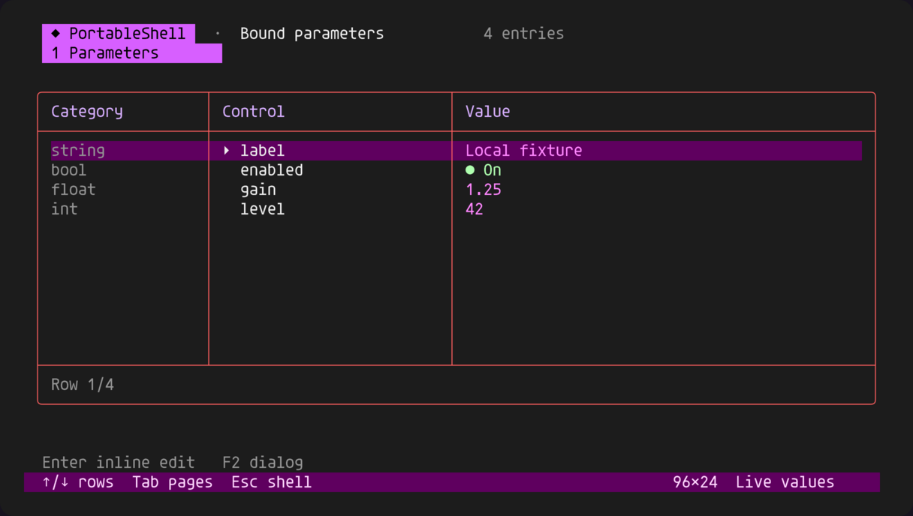

# Preservation and regression audit — 2026-10-29

This pass found real compatibility regressions. Keeping donor history was not
sufficient proof that behavior survived consolidation. The corrections below
use the existing engines and explicit adapters; no donor checkout was reset,
overwritten or replaced with a snapshot.

## Corrections

| Lost or broken behavior | Correction | Executable evidence |
| --- | --- | --- |
| Original API accepted boolean `yes`; adapter rejected it | Case-insensitive `yes/no`, retaining `true/false`, `on/off`, `1/0`; invalid values still rejected | `tests/legacy_checks.c` |
| `ps_print_prompt()` became an idempotent startup call and did nothing for plain output | Every explicit call prints the configured prompt, on its configured sink | Repeated plain and VT100 prompt assertions |
| Original green prompt changed to yellow | Optional adapter uses SGR 32; modern default palette stays violet | Exact emitted prompt bytes; semantic `PS_STYLE_GREEN` |
| Running the same legacy session again after stop/EOF failed to restore terminal modes/prompt | Close retires startup state; run can start again; plain legacy run retains its prompt | Two consecutive `ps_run` invocations |
| Original `help`/`clear` were no longer in the removable adapter registry | Both are registered through the adapter; help enumerates the canonical registry, including modern commands | Unregister/re-register plus `theme` in help |
| Parameter editor lost int/float/string/bool type information | Type names occupy the existing group column, or narrow selected-group caption | Bound metadata assertions and actual output replay below |
| A registry change could invalidate the binding being edited | Register/unregister reject while a draft owns a binding; existing draft can still apply | Rejected mutation followed by successful draft commit |
| Serial keycode mode discarded LF/NUL after CR | Diagnostic mode consumes only the command's pending separator; subsequent bytes remain raw | `Ardush/tests/checks.c`, both raw/parsed echo builds |
| Desktop wide control table repeated the selected category above its category column | Caption is now narrow-layout-only | `tests/checks.c` category occurrence check |
| Pakar's targeted conversation auditor dropped other donor records when its ignored raw cache was absent | Merge refreshed records into the committed inventory; retain other repositories and their exact review evidence | Pakar PR #39; cold-cache/partial/full refresh tests; all 778 PCController/Pealayer records preserved alongside 38 Pakar records |

The repeated plain prompt test and raw CR/LF/NUL keycode test were run against
the pre-fix code and failed, then passed after correction. Other corrections
were established by reading both implementations and adding targeted assertions.

This is the real optional C adapter with four locally bound fixture variables,
captured by `tests/legacy_preview.c` and replayed by `tests/ansi_render.c`.
It is not a physical-device capture. The first render was blank because the
fixture tick preceded the redraw interval; the capture now advances to 100 ms.
The corrected render was inspected. SVG/ANSI sources are beside the PNG.

## Repository-by-repository reconciliation

These are pinned source comparisons, not claims about every feature in every
application or about their installed runtime. Donor identity remains in provenance;
implementation symbols remain semantic.

| Repository / source | Comparison anchor | Result and boundary |
| --- | --- | --- |
| Original `atomicdeploy/portable-shell` | Original implementation `67c5dcb8a63f4055cbdaf02e9ff271c53b46410d`; old main `bbcb4b34110d839c116d8e1e0083e817eaafae33` | Compared original public header, command/parameter/parser/editor lifecycle, VT helpers and socket/serial interfaces with `compat/legacy.c`, current core and native adapters. Corrections above. Original main is an ancestor, original docs/tests/license remain. No second active parser is introduced. |
| Initial local Lumen | `outputs/lumen`; canonical import `9bfbd63e35e22f3f95c91b49cfff365005ec9a85` | All 25 public `lm_*` functions have `ps_*` counterparts. Archive remains intact; import is an ancestor. Parser/history/bindings/tasks/variables/jobs/status/editor/host surfaces remain. Original six palette entries are now checked byte-for-byte for both RGB-request and ANSI fallback paths. This API-name check supplements behavior tests; it is not by itself equivalence proof. |
| `atomicdeploy/PakarController` | Before extraction `b09650e3b424a2dac87b18581c404ef04c6e56d3`; integration `b44a1fba080f7113e1f07d2364a0466a6ffc0c34` | Read the old Telnet/line editor and TUI against shared components and thin wrappers. Original Telnet tests are retained. TUI tests change presentation expectations while retaining draft/cancel/capability/secret/navigation checks. Actual session, metadata, nine-page binding and transport tests pass. Hardware command ownership and authorization remain in `ShellService.h`/`ShellTuiBinding.h`. No production firmware was changed. |
| `DRSDavidSoft/Ardush` (semantic implementation: SerialConsole) | Original `29be66cd4c40fb09475b683b794f11d97ee5abad:Ardush/Ardush.ino`; pre-audit master `386649768601141ef63d9d9074f1069bf517bf89` | Read the full original sketch against current dispatcher, editor/probe and view adapters. All nine original command names remain; 9600 baud and uppercase display remain defaults. Raw echo and optional original exit control bytes have explicit guards. Keycode filtering regression corrected. New view does not replace a prior table: original had no table. |
| `atomicdeploy/pu850-esp` | `431104072952f694a35b3a83c19f13fbb098ca5b`, six files in `command-sources.json` | All six source hashes are unchanged. Yellow prompt, exact raw tail, case-folded names, uppercase display, edit/event redraw and Telnet semantics map to the device-command profile/shared components. WiFi/mDNS/deferred-connect lifecycle and hardware handlers stay in the donor/consumer adapter. No firmware replacement has been performed. |
| Standalone ASA shell files | `Desktop/Projects/Shell/Shell.c` and `Shell.h`, inventory hashes | Both files are unchanged. Active shell commands and yellow prompt compared. Older board-specific `set/send/led` stubs remain in original source and can be bound as raw callbacks; they are not silently advertised as working hardware functions in PortableShell. Disabled examples and the unfinished recursive serial parser were not reinstated as production code. |
| `atomicdeploy/PCController` | Local clean donor `b0111ae0c80dc34149ea1044de7dd5488920301b` | Rechecked `table.go` logical groups, selection, column sizing and value tones; theme and control interaction references against `portable_controls.inc` and the shared device table. Toggles, levels, inline editing, dialogs, explicit observed/pending state and guarded writes remain. Source was not modified. Mouse, compound forms and the hardware/dashboard engines remain separate, documented work—not completed imports. |
| `atomicdeploy/rayanpbx` | `0c71335f424489fa9c8dc2b3e86091684af510f0` snapshot | Rechecked rounded styles, explicit phone-list columns/header sizing, semantic states and per-screen footers. Shared column measurement, rounded frame, header/footer and red accent adaptation remain. Donor uses violet borders; red was the requested adaptation. PBX/SIP operations were never replaced or imported. |
| Pealayer / RayanLamp references inherited through Pakar | Existing Pakar reuse ledger | Their terminal sanitation/form ownership and coordination provenance remain attached to Pakar's mappings. This pass did not replace or edit either application. Their wider donor parity backlog is not certified complete by shell tests. The existing Pakar ledger remains authoritative; this document is not a substitute adjudication of its thousands of entries. |

`preservation-inventory.json` records the checked Git heads, ancestry, branch/stash/
worktree inventory and source fingerprints. Hash equality means source retention,
not semantic completeness. The other active Pakar checkout and its draft PR are
preserved. Shared component pins stay at `e90ffc0` in the consumers because this
pass changes the full C core/hosted adapter and the console dispatcher, not those
vendored headers; repinning unrelated firmware would add no fix.

## Selectable alternatives retained

- `PORTABLE_SHELL_BUILD_LEGACY`: original function API, with hosted allocation;
  direct byte API remains heap-free. `PORTABLE_SHELL_USE_LIBC` explicitly selects
  host memory primitives; it is never inferred from CPU or OS.
- Device command profile: raw tail semantics, yellow prompt and caller-owned
  hardware commands; modern parsed commands can coexist.
- `theme lumen|violet|red|onedark`, color/mono/ASCII/Unicode settings, configurable
  grid/title/border flags. The original Lumen palette remains available.
- `PS_DEVICE_VIEW_TABLE=0`, `PS_DEVICE_VIEW_INLINE_EDIT=0` retain the simpler
  device renderer/below-table editor; default remains rich. Category-column,
  matrix, widgets, dialogs and diagnostics are explicit feature flags. No MCU mode.
- `PS_WORKSPACE_INLINE_EDIT=0` retains the earlier desktop workspace editor.
- Serial `PS_CONSOLE_RAW_ECHO` and `PS_CONSOLE_LEGACY_EXIT_BYTES` preserve explicit
  command dialect differences. Empty prompt label/style reproduce the old plain
  `> ` presentation while keeping ANSI editing. Default remains vibrant.
- The event editor accepts `PS_EDITOR_PROMPT_STYLE`; calling `setTheme(255)` uses
  that style, including the former green prompt. Pakar deliberately selects its
  session theme instead. This is an intentional requested presentation change.

Removed active duplicates are recoverable from named Git revisions or the intact
Lumen/standalone archives. They are not kept as competing compiled engines merely
to avoid a deletion in a diff. Different useful behavior is retained through the
shared engine, adapters or explicit flags. Unsafe old overflow, silent truncation,
blocking escape/probe loops and optimistic hardware-success behavior are not
compatibility features to restore.

## Validation and limits

- Native portable + optional original API: 8/8 CTest targets passed, including
  original tests and socket/UDP loopback; zero undefined core symbols.
- Native libc + optional original API: 8/8 passed; symbol audit permits only the
  selected host primitives.
- Retained table-off/inline-off device layout: 8/8 passed.
- Serial consumer: 6/6 passed, covering raw/parsed echo, ASCII view, Telnet and
  exact shared-source hashes.
- Pakar's approved `test-shell.ps1`, `test-shell-properties.ps1` and metadata
  check passed: real session/service code, nine-page binding, original editor/TUI
  tests, secret/capability policies, TCP/UDP loopback and pinned source checks.
- Full original and imported histories were checked as ancestors. Eight PU/ASA
  source files still match the earlier inventory. No force push/reset or donor
  overwrite was used.

CI, board execution, physical colors, human interaction and deployment are
separate evidence. This pass does not certify an installed AVR/STM32/ESP upgrade,
nor complete ncurses/grapheme/mouse parity or every PCController/PBX feature.
The detailed integration/design documents retain those boundaries. Final PR
and CI identities are recorded in the delivery section when observed.

## Published repair checkpoints

- PortableShell PR [#9](https://github.com/atomicdeploy/portable-shell/pull/9),
  code `51fcff1594bf8d86f81f30044d31989d57e5c536`: all 13 CI jobs passed,
  including three native hosts, both memory backends, ASCII/compact/retained
  layouts/LTO, ARM32 and AVR components. This subsequent report update is docs-only.
- Serial console PR [#6](https://github.com/DRSDavidSoft/Ardush/pull/6),
  `a8875e0b00545beb6bd176ca85baee5cb697a252`: all seven CI jobs passed,
  including three native hosts, Uno/Mega/STM32 builds and AVR simulation.
- Additional audit-tool repair PR
  [#39](https://github.com/atomicdeploy/PakarController/pull/39),
  `9098dad`: restores inventory preservation; focused native tooling tests pass.
  Its package CI and merge are not yet attested here. The rejected generated
  deletion was never committed. No application source was lost in that incident.
- Existing contextual TUI PR [#38](https://github.com/atomicdeploy/PakarController/pull/38)
  remains a separate final package-CI/merge gate at this checkpoint. The other
  task's draft PR #37 is untouched.

Local Windows 0.13.1 builds: portable executable 58,880 bytes, libc executable
81,920 bytes. Session storage remains 29,784 bytes (no new session fields).
These are executable/caller-owned-storage measurements, not peak process RAM.
New binaries are saved alongside previous versions, preserving running sessions.
