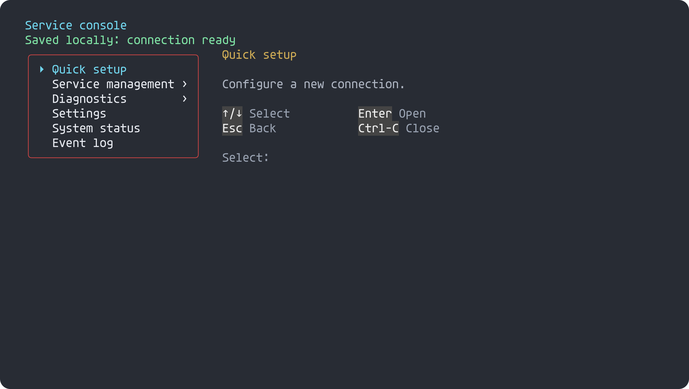

# Animated terminal previews

The optional **host-side** `terminal_animation` tool turns a timed recording of
emitted terminal bytes into a standalone animated SVG. It shares the ANSI parser,
cell model, color conversion and Unicode border drawing in `tests/render.c` with
the static previews. Nothing is added to firmware, library sessions or transports.

[Play the recorded session](https://raw.githubusercontent.com/atomicdeploy/portable-shell/main/previews/terminal-session.svg)
— typing, nested menus, a callback, required-field validation and form editing.
This deterministic fixture drives the actual PortableShell input handlers with
simulated application data; it does not contact a device.



## Build and export

From the repository root, with the native GCC toolchain:

```sh
cmake -S . -B build -DPORTABLE_SHELL_BUILD_TESTS=ON
cmake --build build --target terminal_animation animation_demo animation_checks
ctest --test-dir build -R animation_checks --output-on-failure
build/animation_demo session.psrec
build/terminal_animation session.psrec session.svg --poster session-static.svg
```

Windows executables have `.exe`; multi-configuration generators place them in
the selected configuration directory. The standalone exporter can also be built
with `gcc -std=c99 -O2 tools/terminal_animation.c -o terminal_animation`.

| Option | Behavior |
| --- | --- |
| Default | Loop at recorded speed, with terminal-controlled cursor blinking |
| `--once` | Play once and retain the final screen |
| `--speed 2` | Double playback speed; accepts 0.01–100 |
| `--no-blink` | Show visible cursors steadily |
| `--font path/to/Agave.ttf` | Embed the font; no font installation/network required |
| `--poster session-static.svg` | Export the final screen with a steady cursor |

The gallery embeds the pinned Agave font and ships its [license](../../previews/Agave-LICENSE.txt).
Without `--font`, install Agave for the intended typography. Other glyph fallback
fonts remain the viewer's responsibility.

## Recording a consumer

Use `tools/terminal_recording.h` in a host harness. Start with
`ps_record_begin(file, columns, rows)`. In the consumer's output callback, call
`ps_record_event(file, now_ms, 'O', bytes, length)` before forwarding the same bytes
to its real terminal. Use a monotonic host clock relative to the recording start.
After each complete input/tick/redraw transaction, append an `F` checkpoint.
Finish with `E` at a later timestamp to retain the final screen for that interval.

`I` records optionally annotate input. They are counted but **never executed,
echoed or copied into the SVG**. Omit input recording for passwords; displayed
output can also contain private data. The demonstration records only fixture input.

The binary-safe format is deliberately small:

```text
PSREPLAY 1 <columns> <rows> LF
<milliseconds> <O|I|F|E> <byte_count> LF
<exactly byte_count raw bytes> LF
```

`F` and `E` have zero payload, so their header is followed by an empty line.
Times are nondecreasing. Equal-time checkpoints replace the previous checkpoint;
unchanged frames retain their duration without adding another visual checkpoint.
Identical screen/cursor states reuse the same SVG definition, including states
revisited later. Output chunks may split UTF-8 and escape sequences. A checkpoint
should follow complete output, not an intermediate repaint. An `E` record must
follow a checkpoint, have a later timestamp, and be the final record.

Limits are explicit: fixed viewport per recording (1–240 columns, 1–100 rows),
1 MiB per record, 64 MiB input payload/retained drawings, 1,024 unique frames and
visual checkpoints, and 24 hours. Oversized or incomplete captures fail instead
of silently truncating. Split long sessions into recordings. The shared parser is
a preview subset of VT, not a complete terminal emulator: arbitrary third-party
screen programs, scroll regions, alternate-buffer restoration and resizing within
a recording are not yet represented. PortableShell's complete redraws are captured
as emitted; the fixture keeps one viewport throughout.

## Playback and fallback

Playback uses standard SVG `<animate>` with discrete frame transitions, no script
and no live command execution. Cursor visibility (`CSI ?25 h/l`) and block,
underline or bar shape (`CSI Ps SP q`) are preserved, including steady variants.
Title/path OSC payloads are consumed without appearing as text. ANSI styles and
colors use the shared cell drawing implementation.

The final screen sits behind the animated frames, so an SVG viewer without
animation support still displays useful content. `prefers-reduced-motion` hides
the animation and exposes that static frame. Hosts that sanitize animation or
embedded fonts may show a static preview; open the SVG directly in a supporting
browser. See the [SVG animation reference](https://developer.mozilla.org/en-US/docs/Web/SVG/Reference/Element/animate).

The [gallery](Gallery.md) rebuild generates the recording, animated SVG, static
SVG and antialiased PNG from current source. Existing CI freshness checks cover
all four artifacts and the embedded font's license:

```sh
cmake -DMODE=UPDATE -DGENERATOR=Ninja -P tools/rebuild-previews.cmake
cmake -DGENERATOR=Ninja -P tools/rebuild-previews.cmake
```
