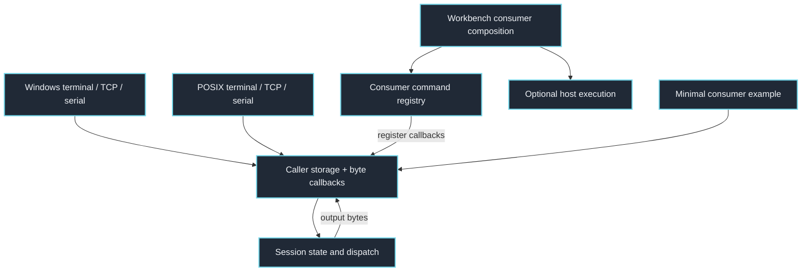
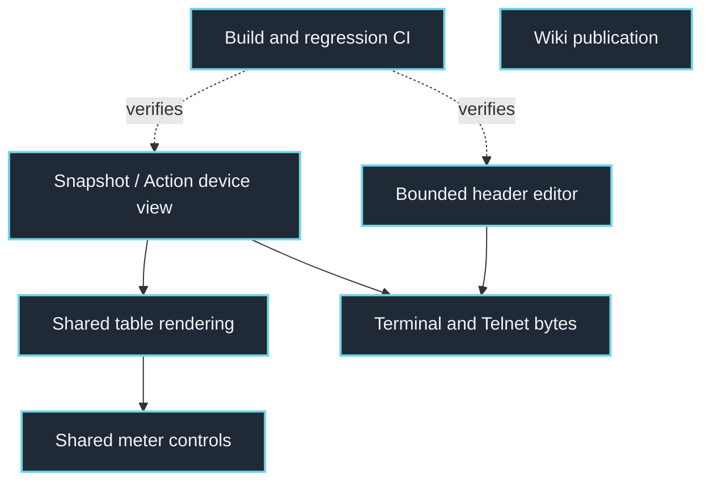

# PortableShell: clickable system maps

Two compositions share portable components: the full C session framework and the standalone header-based editor/device view. Consumers own commands, settings, validation and hardware. Only optional host adapters own OS calls.

Click a component to inspect its implementation. Links are pinned to source commit `3a7eeba179c238226deef1b64e3bd3b86c4e12e7`, so this map remains inspectable as the code evolves. Arrows describe source-level relationships, not proof of deployment or physical behavior.

## Framework and host boundaries

External execution belongs to the host and is disabled by default. Register commands in a consumer; the framework starts with an empty registry.



## Input, UI and asynchronous work

The caller feeds bytes and monotonic ticks. Rendering emits bytes through callbacks; async support is cooperative and does not create OS threads.

```mermaid
flowchart TD
    session["ps_feed / ps_tick"]
    parse["Arguments and quoting"]
    editor["Full-session text editing"]
    history["History and recall dialog"]
    controls["Editable tables and values"]
    hex["Optional binary editor"]
    async["Cooperative task primitives"]
    screen["Optional retained screen"]
    style["Semantic color roles"]
    session --> parse
    session --> editor
    editor --> history
    session --> controls
    session --> hex
    session --> async
    controls --> style
    screen --> style
    click session "https://github.com/atomicdeploy/portable-shell/blob/3a7eeba179c238226deef1b64e3bd3b86c4e12e7/src/portable_shell.c" "Inspect src/portable_shell.c" _blank
    click parse "https://github.com/atomicdeploy/portable-shell/blob/3a7eeba179c238226deef1b64e3bd3b86c4e12e7/include/portable_parse.h" "Inspect include/portable_parse.h" _blank
    click editor "https://github.com/atomicdeploy/portable-shell/blob/3a7eeba179c238226deef1b64e3bd3b86c4e12e7/src/portable_editor.inc" "Inspect src/portable_editor.inc" _blank
    click history "https://github.com/atomicdeploy/portable-shell/blob/3a7eeba179c238226deef1b64e3bd3b86c4e12e7/src/portable_history.inc" "Inspect src/portable_history.inc" _blank
    click controls "https://github.com/atomicdeploy/portable-shell/blob/3a7eeba179c238226deef1b64e3bd3b86c4e12e7/src/portable_controls.inc" "Inspect src/portable_controls.inc" _blank
    click hex "https://github.com/atomicdeploy/portable-shell/blob/3a7eeba179c238226deef1b64e3bd3b86c4e12e7/src/portable_hex.inc" "Inspect src/portable_hex.inc" _blank
    click async "https://github.com/atomicdeploy/portable-shell/blob/3a7eeba179c238226deef1b64e3bd3b86c4e12e7/include/portable_async.h" "Inspect include/portable_async.h" _blank
    click screen "https://github.com/atomicdeploy/portable-shell/blob/3a7eeba179c238226deef1b64e3bd3b86c4e12e7/include/portable_screen.h" "Inspect include/portable_screen.h" _blank
    click style "https://github.com/atomicdeploy/portable-shell/blob/3a7eeba179c238226deef1b64e3bd3b86c4e12e7/include/portable_style.h" "Inspect include/portable_style.h" _blank
    classDef component fill:#202936,stroke:#71d5e8,color:#f0f3f7,stroke-width:2px
    class session,parse,editor,history,controls,hex,async,screen,style component
```

## Standalone consumers and update pipeline

Header-based consumers do not automatically acquire full-session features such as the F7 dialog or hex editor. Exact source pins and consumer tests must accompany updates.



## Source index

These links also work in readers that disable clickable diagram nodes.

- [host/windows.c](https://github.com/atomicdeploy/portable-shell/blob/3a7eeba179c238226deef1b64e3bd3b86c4e12e7/host/windows.c)
- [host/posix.c](https://github.com/atomicdeploy/portable-shell/blob/3a7eeba179c238226deef1b64e3bd3b86c4e12e7/host/posix.c)
- [include/portable_shell.h](https://github.com/atomicdeploy/portable-shell/blob/3a7eeba179c238226deef1b64e3bd3b86c4e12e7/include/portable_shell.h)
- [src/portable_shell.c](https://github.com/atomicdeploy/portable-shell/blob/3a7eeba179c238226deef1b64e3bd3b86c4e12e7/src/portable_shell.c)
- [host/workbench.c](https://github.com/atomicdeploy/portable-shell/blob/3a7eeba179c238226deef1b64e3bd3b86c4e12e7/host/workbench.c)
- [host/workbench/registry.inc](https://github.com/atomicdeploy/portable-shell/blob/3a7eeba179c238226deef1b64e3bd3b86c4e12e7/host/workbench/registry.inc)
- [host/execution.h](https://github.com/atomicdeploy/portable-shell/blob/3a7eeba179c238226deef1b64e3bd3b86c4e12e7/host/execution.h)
- [examples/consumer_commands.c](https://github.com/atomicdeploy/portable-shell/blob/3a7eeba179c238226deef1b64e3bd3b86c4e12e7/examples/consumer_commands.c)
- [include/portable_parse.h](https://github.com/atomicdeploy/portable-shell/blob/3a7eeba179c238226deef1b64e3bd3b86c4e12e7/include/portable_parse.h)
- [src/portable_editor.inc](https://github.com/atomicdeploy/portable-shell/blob/3a7eeba179c238226deef1b64e3bd3b86c4e12e7/src/portable_editor.inc)
- [src/portable_history.inc](https://github.com/atomicdeploy/portable-shell/blob/3a7eeba179c238226deef1b64e3bd3b86c4e12e7/src/portable_history.inc)
- [src/portable_controls.inc](https://github.com/atomicdeploy/portable-shell/blob/3a7eeba179c238226deef1b64e3bd3b86c4e12e7/src/portable_controls.inc)
- [src/portable_hex.inc](https://github.com/atomicdeploy/portable-shell/blob/3a7eeba179c238226deef1b64e3bd3b86c4e12e7/src/portable_hex.inc)
- [include/portable_async.h](https://github.com/atomicdeploy/portable-shell/blob/3a7eeba179c238226deef1b64e3bd3b86c4e12e7/include/portable_async.h)
- [include/portable_screen.h](https://github.com/atomicdeploy/portable-shell/blob/3a7eeba179c238226deef1b64e3bd3b86c4e12e7/include/portable_screen.h)
- [include/portable_style.h](https://github.com/atomicdeploy/portable-shell/blob/3a7eeba179c238226deef1b64e3bd3b86c4e12e7/include/portable_style.h)
- [include/portable_editor.h](https://github.com/atomicdeploy/portable-shell/blob/3a7eeba179c238226deef1b64e3bd3b86c4e12e7/include/portable_editor.h)
- [include/portable_device_view.hpp](https://github.com/atomicdeploy/portable-shell/blob/3a7eeba179c238226deef1b64e3bd3b86c4e12e7/include/portable_device_view.hpp)
- [include/portable_device_table.hpp](https://github.com/atomicdeploy/portable-shell/blob/3a7eeba179c238226deef1b64e3bd3b86c4e12e7/include/portable_device_table.hpp)
- [include/portable_terminal.h](https://github.com/atomicdeploy/portable-shell/blob/3a7eeba179c238226deef1b64e3bd3b86c4e12e7/include/portable_terminal.h)
- [include/portable_meter.h](https://github.com/atomicdeploy/portable-shell/blob/3a7eeba179c238226deef1b64e3bd3b86c4e12e7/include/portable_meter.h)
- [.github/workflows/build.yml](https://github.com/atomicdeploy/portable-shell/blob/3a7eeba179c238226deef1b64e3bd3b86c4e12e7/.github/workflows/build.yml)
- [.github/workflows/docs.yml](https://github.com/atomicdeploy/portable-shell/blob/3a7eeba179c238226deef1b64e3bd3b86c4e12e7/.github/workflows/docs.yml)

## Consumer integration

See the [consumer source maps](https://github.com/atomicdeploy/portable-shell/blob/abcb3a6/docs/Attribution.md#consumer-maps). A prospective device migration must preserve application commands and persistence semantics; desktop demo commands are not device replacements.
