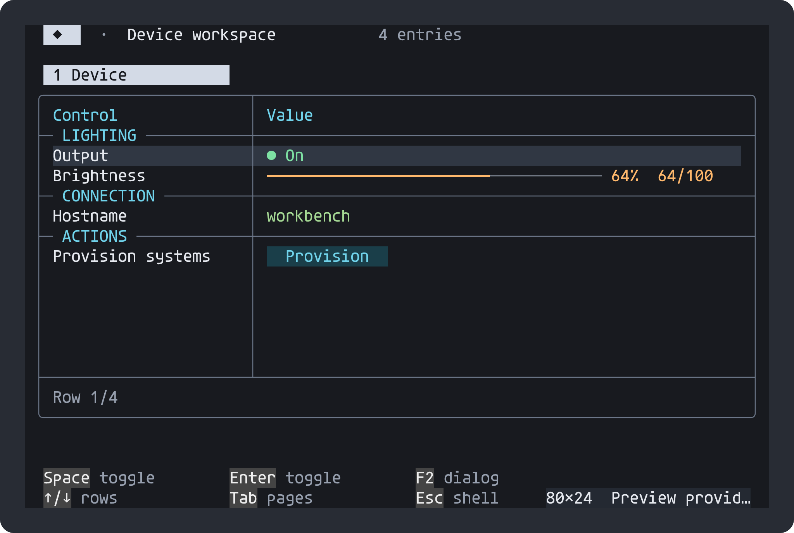
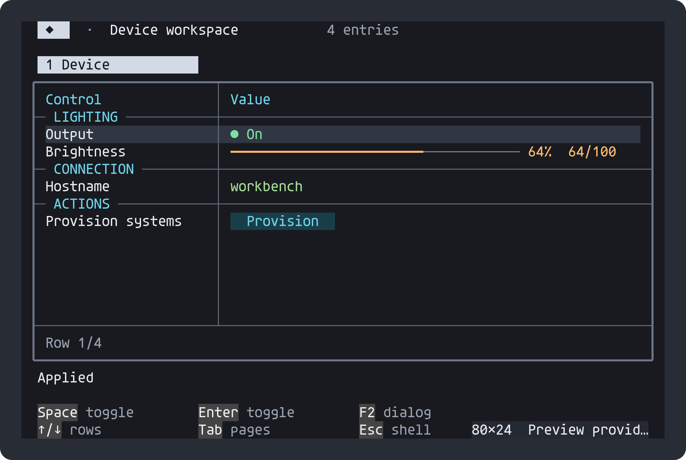
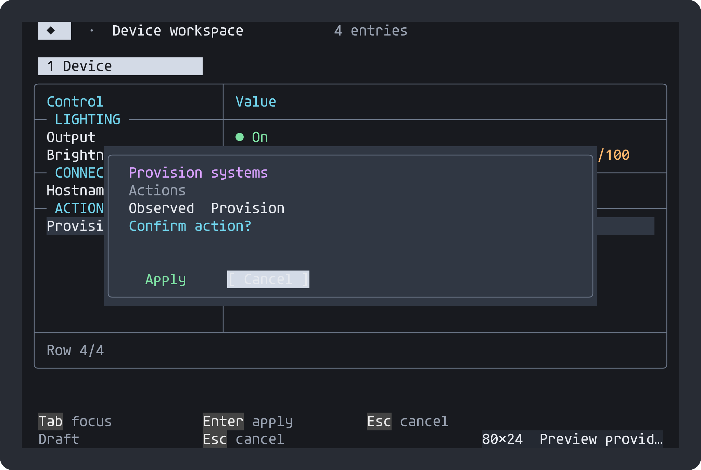
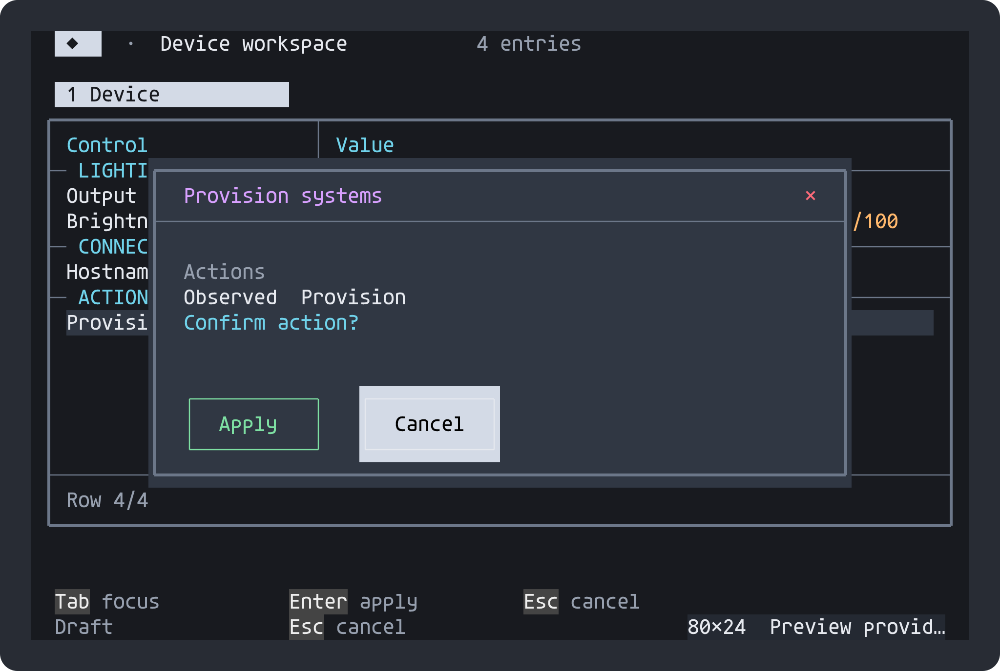
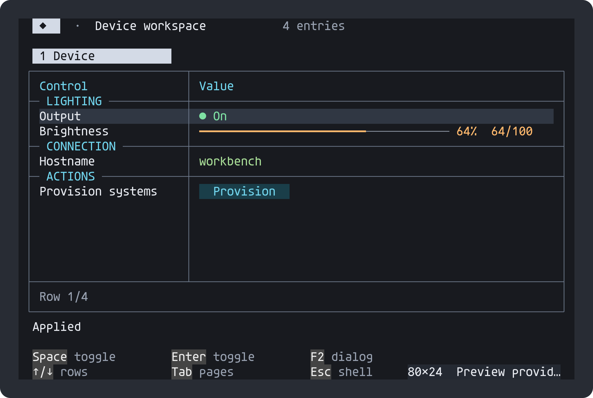
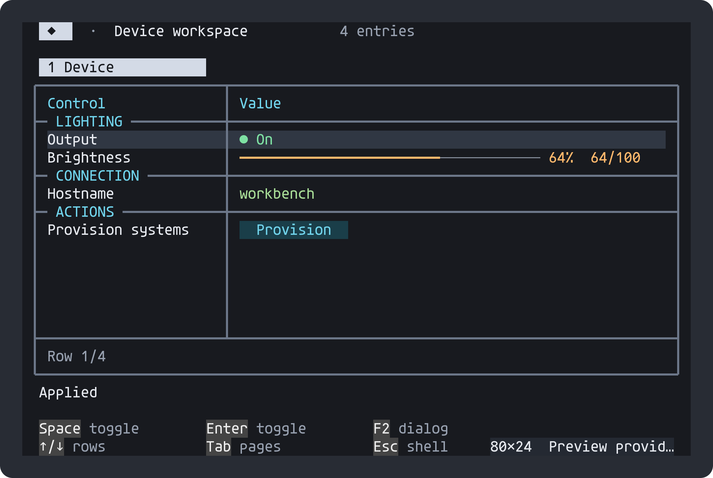
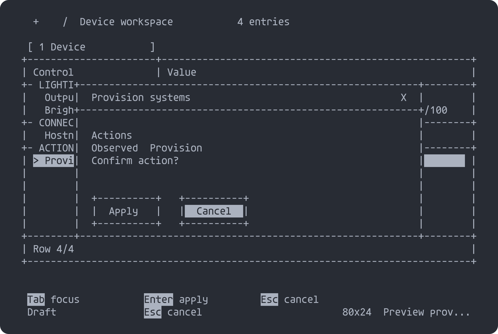

# Frame styles

Frames are presentation, independent of palettes and table layout. The default
remains rounded. The C session and optional C++ snapshot/action view share
[`portable_border.h`](https://github.com/atomicdeploy/portable-shell/blob/main/include/portable_border.h),
including mixed-weight junctions. No alternative renderer or OS dependency is added.

| Style | Constant | Outer frame | Interior dividers |
| --- | --- | --- | --- |
| Rounded (default) | `PS_BORDER_ROUNDED` | `╭─╮ │ ╰─╯` | `├─┼─┤` |
| Square | `PS_BORDER_SINGLE` | `┌─┐ │ └─┘` | `├─┼─┤` |
| Heavy frame, light dividers | `PS_BORDER_HEAVY_FRAME` | `┏━┓ ┃ ┗━┛` | `┠─┼─┨`, top `┯`, bottom `┷` |
| Heavy | `PS_BORDER_HEAVY` | `┏━┓ ┃ ┗━┛` | `┣━╋━┫` |
| Double | `PS_BORDER_DOUBLE` | `╔═╗ ║ ╚═╝` | `╠═╬═╣` |

## Select a style

```c
ps_set_border_style(session, PS_BORDER_HEAVY_FRAME);
/* Optional for typed-control dialogs, independently selectable: */
ps_set_dialog_style(session, PS_DIALOG_TITLE_BAR | PS_DIALOG_FRAMED_BUTTONS);
```

The C setter affects tables, dashboards, choice popups and the shared frames used
by menus, text/hex editors, forms, file views and bordered prompts. It marks the
session dirty; views display the selected style on their next render. Changing it
does not cancel an edit or move its cell origin.

```cpp
PortableShell::DeviceView view;
view.setBorderStyle(PS_BORDER_HEAVY_FRAME);
```

Both retained and reduced device tables use this setter. The optional dialog
title bar and framed-button flags belong to the C typed-control dialogs;
DeviceView keeps its own existing dialog layout, with the selected frame glyphs.

Dialog buttons retain keyboard focus and confirmation behavior. Tab/Shift+Tab
or ←/→ changes focus; Enter activates it. Apply and Cancel have three-row mouse
targets matching their frames. The title's `×` closes the dialog; action dialogs
start on Cancel. These are working controls, with no decorative minimize or
maximize symbols. Consumers still supply action labels and execute actions through
their own write callbacks. Inline editing remains available.

## Build controls and terminal capabilities

- `PS_BORDER_DEFAULT=PS_BORDER_HEAVY_FRAME` changes the initial frame style.
- `PS_BORDER_STYLES=0` removes alternative glyph tables and style storage;
  rounded remains available, and setters reject other styles.
- `PS_DIALOG_STYLES=0` removes the optional button renderer/style storage;
  requests for nonzero dialog flags are rejected.
- Without `PS_UNICODE`, frames fall back to `+`, `-`, `|` and close to `X`.
  Without `PS_COLOR`, focus remains visible using inverse video.

Pass definitions consistently to the library and consumer translation units.
The border set uses single-cell Unicode box-drawing characters, without emoji or
variation selectors. Layout and mouse calculations use cells, never UTF-8 byte
lengths. A terminal/font still needs box-drawing support; select ASCII for terminals
with incompatible width policies. Color selection remains independent.

## Actual output: before and after

These are simulated provider values captured from C byte output, rendered with
pinned Agave and antialiasing. They do not represent a hardware test.

| Rounded default | Heavy frame with light dividers |
| --- | --- |
|  |  |

| Existing dialog | Title bar and framed buttons |
| --- | --- |
|  |  |

| Square | Heavy | Double |
| --- | --- | --- |
|  |  |  |



[`border_checks.c`](https://github.com/atomicdeploy/portable-shell/blob/main/tests/border_checks.c)
is the runnable configuration example and replay test. It checks single-cell glyphs,
stable table/edit positions, editing through style changes, confirmation/cancellation,
mouse button borders/gaps/close, a 42×14 viewport and ASCII fallback. C++ full and
reduced table tests exercise the same style set. Rebuild with the standard
[preview workflow](Animated-previews.md); these eight captures are managed by CI.
