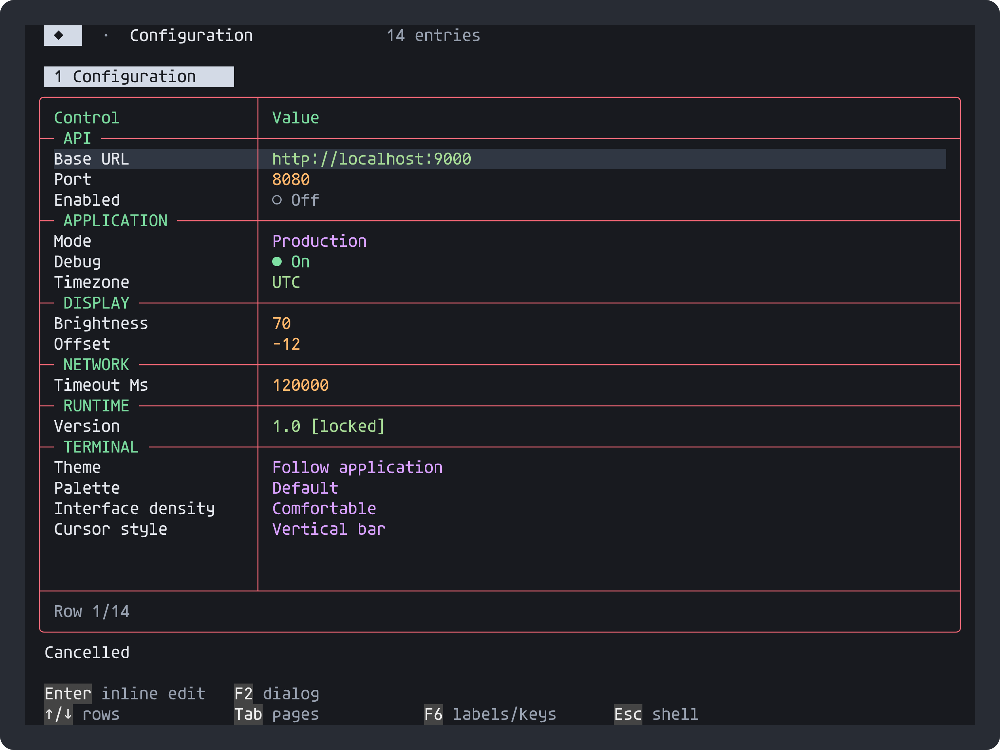
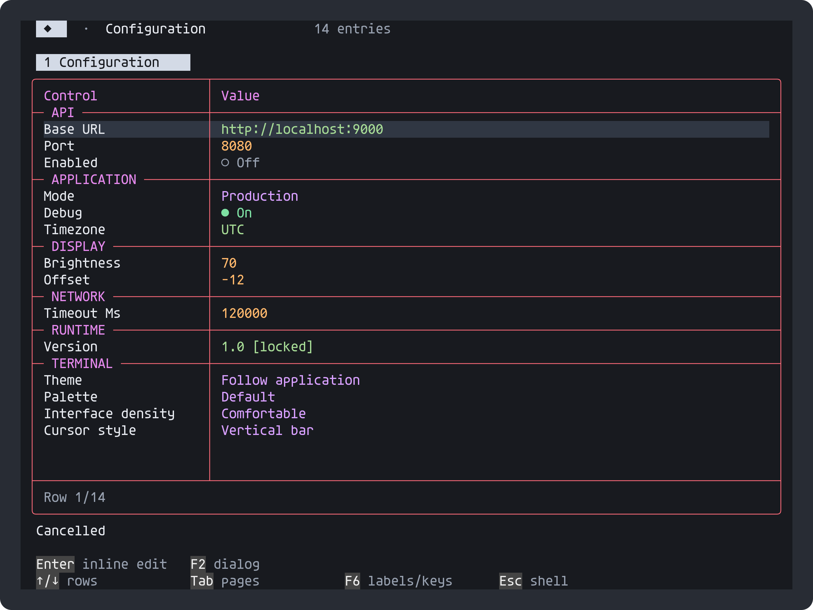

# Semantic application accent

PortableShell can emit an explicit application-accent foreground token. This is
a private, namespaced OSC extension, not a standard color number or an RGB
heuristic. Normal cyan/ANSI color 6 is never implicitly mapped to the accent.

```c
#include "portable_style.h"
ps_set_semantic_accent(session, 1, 0);
ps_message(session, PS_STYLE_ACCENT, "Connected");
/* Optional: map specific UI semantic roles as well. */
ps_set_semantic_accent(session, 1, 1u << PS_INK_HEADING);
```

`PS_STYLE_ACCENT` works in prompt parts and styled messages; `PS_INK_ACCENT`
works in panel text roles. The default role mask is zero. A consumer can opt
headings/actions into accent coloring while keeping unrelated cyan untouched.

## Byte contract

Emit a conventional foreground fallback first, then:

```text
ESC ] 777;ps;ink;accent ESC \
```

The exact C literal is `PS_SEMANTIC_ACCENT_SEQUENCE` in
[`portable_semantic.h`](../../include/portable_semantic.h). Explicit accent spans
use RGB `(216,160,255)` or indexed color `183`; mapped roles retain their usual
fallback (for example, cyan headings). Terminals that ignore unknown OSC sequences
leave that conventional fallback visible. The marker does
not change the palette, background, font, title or execute anything.

Supporting renderers retain a **semantic Accent foreground**, alongside its
fallback, in each terminal cell and resolve it to the application's current accent
at paint time. A later accent preference change therefore recolors retained
cells without replaying the command or guessing from their RGB values.

| Following input | Accent foreground |
| --- | --- |
| SGR `0`, `39`, `30..37`, `90..97` | Clear role; use specified/default foreground |
| SGR `38;5;n` or `38;2;r;g;b` | Clear role; use explicit foreground |
| SGR `40..47`, `100..107`, `49`, `48;5;n`, `48;2;r;g;b` | Preserve role; change only background |
| Bold, dim, italic, underline and their resets | Preserve role |
| Unknown OSC / unknown semantic payload | Ignore; preserve existing state |
| Erase, scrolling, resizing or cell copy | Apply/copy the cell's role with its ordinary attributes |

Parse extended SGR colors as complete units: the `38` inside `48;5;38` is a
background palette index, not a foreground reset. Reverse video exchanges the
rendered foreground/background including their semantic identity.

OSC/ST and UTF-8 may be split at **any byte boundary**, including between ESC and
`]`, or between ESC and `\\`. Buffer bounded payloads until ST; accept BEL as
an alternative terminator. Discard overlong/malformed payloads as a whole. The
freestanding `ps_semantic_osc_role(payload, length)` recognizes only a complete,
exact payload, excluding introducer/terminator. It does not parse a full VT stream.

## Capability and fallback

Emission is disabled until the host opts in. `PS_SEMANTIC_ACCENT=0`, `PS_OSC=0`,
`PS_NO_OSC`, no-color and non-interactive output all suppress the marker. Ordinary
SGR fallback remains where color is enabled. The host decides whether its byte
consumer supports OSC; PortableShell probes no OS APIs and installs no transport.
Call `ps_set_semantic_accent(session, 0, 0)` to stop future markers. Consumers should
use a normal foreground SGR/reset when ending their own manually emitted spans.

## Emitted-output evidence

These are the same captured settings screen, with retained semantic heading cells
resolved to two accent values by the C replay renderer. They are fixture evidence,
not screenshots of a particular application's native/Web renderer.





`semantic_checks` exercises actual emission, opt-out/plain output, one-byte input,
independent cyan, live recoloring, unknown OSC, erasure, and foreground/background
SGR rules. `settings_editor_checks` produces the pictures from actual callbacks
and key/mouse events. Rebuild with `cmake -DMODE=UPDATE -P tools/rebuild-previews.cmake`.
