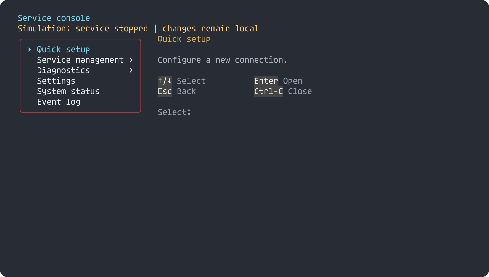
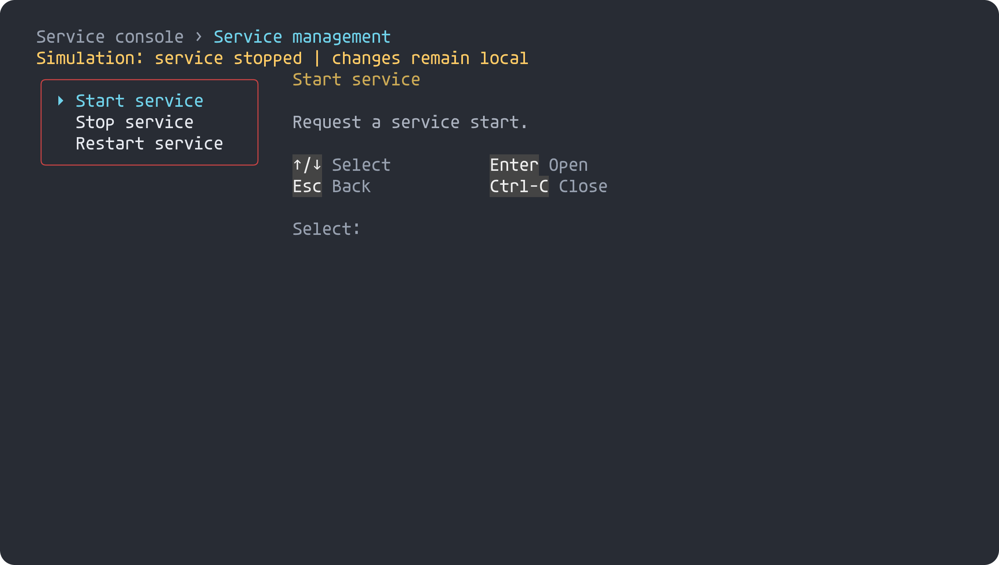
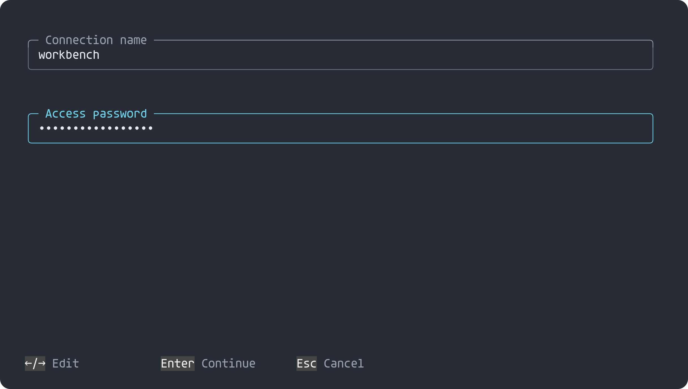

# Service consoles

PortableShell supplies presentation and input handling. The consumer supplies its
menu labels, observations, validation, permissions and operations. Opening a menu
must not implicitly synchronize configuration or restart a service.

The [service-menu example](https://github.com/atomicdeploy/portable-shell/blob/main/examples/service_menu.h)
is a caller-owned nested tree with a status callback and action dispatcher. The
[executable example and checks](https://github.com/atomicdeploy/portable-shell/blob/main/tests/menu_context_checks.c)
use a local simulation, including a setup form. They do not contact a server.

## Choose the view for each workflow

| Workflow | PortableShell building blocks | Consumer responsibility |
| --- | --- | --- |
| Main menu, service operations, diagnostics, call tests, routing and intercom | `ps_menu`, `ps_menu_item`, `PS_MENU_TABLE`, `PS_MENU_DETAILS`, `PS_MENU_BREADCRUMBS`, `PS_MENU_MARKER` | Register only supported actions; confirm consequential operations before dispatch |
| Connection/setup wizard, add account, authentication | `ps_form`, `PS_FORM_TEXT`, `PS_FORM_PASSWORD`, `PS_FORM_CHOICE`, validation and completion callbacks | Validate values, retain drafts, apply only after acceptance, clear secrets when finished |
| Account/endpoint/trunk inventory | The same menu model with `PS_MENU_LIST`; descriptions, filtering, pagination and disabled entries | Supply stable records and current registration/availability observations |
| System preferences, configuration editor | `ps_panel_attach`, typed controls, tabs, grouped headings, inline editing and scrollbars | Implement read/write callbacks and reject invalid or read-only writes; persist explicitly |
| System/service status | `ps_print_report`, or a panel with `PS_PANEL_GRID` | Fetch actual service, database and network observations; distinguish unknown from off |
| Usage and command reference | Registered command definitions and help metadata | Supply command summaries, parameters and examples; host-only execution stays in the host |
| Event log and live console | `portable_monitor.h`, `ps_monitor_append`, task updates, scrolling, severity filtering and pause/resume | Deliver actual events, timestamps and retention; use append-only output for non-interactive streams |

See [Menus](Menus.md), [Shell forms](Shell.md), [Workspace](Workspace.md),
[Monitoring](Monitoring.md), [Commands](Commands.md) and [Async](Async.md).

## Context without hidden work

`ps_menu_set_notice` receives the current menu and returns a short borrowed message
plus a semantic `PS_INK_*` role. Update the provider's state and call
`ps_menu_refresh` after an event. A status line can report disconnected, checking,
ready or failed; the renderer never performs the check itself.

Breadcrumbs preserve orientation in nested menus. Esc restores the selected parent
item. A description panel explains the current action. Pointer selection is an
optional alternative to a filled row; existing menu defaults remain unchanged.
Descriptions and notices are clipped to available width. Long instructions belong
in a separate document/help view rather than the single-line status callback.

When an action starts an asynchronous operation, return control to the consumer's
event loop. Feed keys through `ps_feed`, advance time through `ps_tick`, deliver
provider completion on the same serialized session context, and refresh the view.
The framework does not create threads, poll the OS, or grant action authorization.

## Explicit feature selection

Use `PS_MENU_CONTEXT=0` to omit breadcrumbs, notice state and parent-selection
storage; `PS_MENU_LIST_VIEW=0` to omit list filtering; `PS_FORM=0` to omit forms.
Password fields reuse the existing form editor and are removed with forms. Runtime
styles choose filled versus pointer selection independently. Unicode/color flags
retain ASCII and monochrome fallbacks. No architecture name selects a reduced UI.

These are original C extensions to the existing menu/form implementations. No
terminal UI framework or service management backend is linked into the core.

