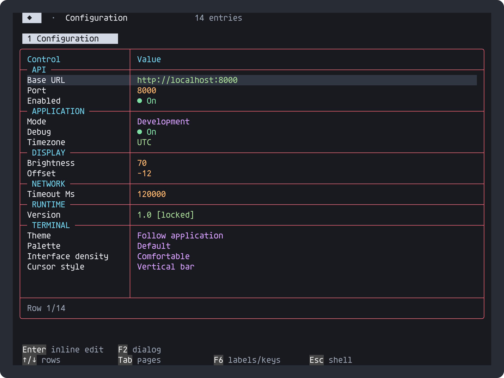
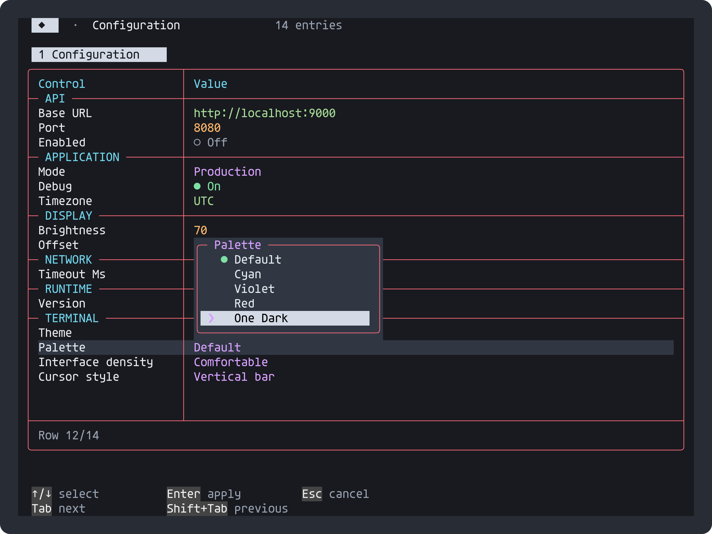
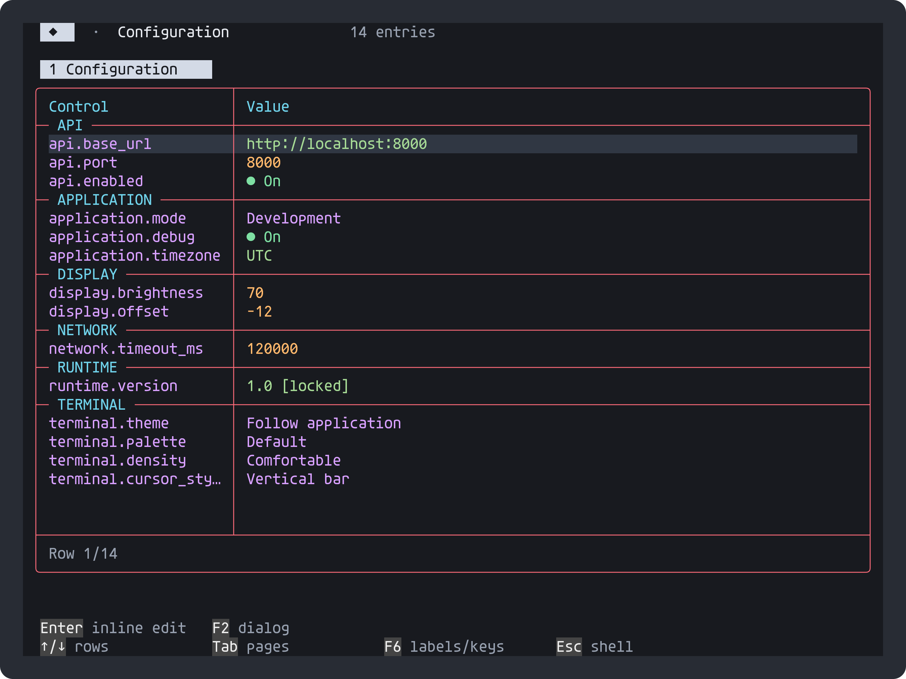

# Dotted-key configuration editor

The optional [registry adapter](../../include/portable_settings_editor.h) presents
registered typed settings in the existing editable table. Human-readable labels
are the default; the example's **F6** switches to violet dotted keys. Keys such as
`api.base_url`, `api.port` and `application.mode` are literal registry identifiers: dots organize the
presentation; they do not implicitly create nested objects or parse a file format.



This is actual input-driven output using a synthetic, in-memory consumer model.
The earlier [service-console example](Service-console.md) remains available;
this adapter connects the same table directly to `ps_settings`, avoiding a second
value store or duplicated validation rules.

## Run the native example

```sh
cmake -S . -B build/settings -DPORTABLE_SHELL_SETTINGS_EXAMPLE=ON
cmake --build build/settings --target portable_shell_settings
build/settings/PortableShellSettings
```

On Windows, run `build/settings/PortableShellSettings.exe`. Enter `configure` to
open the editor. Enter edits a value inline; F2 opens its dialog; Space toggles a
boolean; ←/→ changes choices or bounded numbers. Group headings collapse/expand,
the table scrolls and resizes, and Esc returns to the prompt. The existing
terminal/mouse, Unicode/ASCII and color/monochrome settings apply.

Choice controls open a popup with **Enter**, **Space**, **F2**, or a value click.
Enter/Space and a value click attach the dropdown to the value field, flipping
above it when needed; F2 retains a centered modal presentation.
↑/↓ and Tab/Shift+Tab move the draft selection with rollover; Home/End and
PageUp/PageDown navigate longer lists. The wheel scrolls the selection. Enter
or clicking an option commits; Esc or right-click cancels. The circle marks the
saved value, while the highlighted row marks the draft. Large lists scroll inside
the popup, and stale observations or changed choices cancel the editor safely.
Other text and numeric controls retain inline editing.





The example also registers `config` using the existing registry command callback:

```text
config api.port
config api.port 9000
config application.mode Production
configure
```

Both interfaces read and write the same values and invoke the same validation.
The optional native example also supports the host's loopback Telnet server:
`PortableShellSettings --listen 2323 --bind 127.0.0.1`. Connect to `127.0.0.1:2323`
and enter `configure`. Each client has its own demonstration model, reset on
reconnection. External process execution is disabled in this example.

## Embed with consumer-owned settings

```c
#include "portable_settings_editor.h"

static ps_settings_editor editor;
static ps_control controls[32];
static ps_settings_editor_row rows[32];

/* Register your own ps_setting descriptors and callbacks in registry first. */
if (ps_settings_editor_init(&editor, &registry, controls, rows,
                            PS_COUNT_OF(rows), "Configuration")) {
    ps_set_table_style(session, PS_TABLE_DEFAULT | PS_TABLE_RED_BORDER);
    ps_settings_editor_open(&editor, session);
}
```

An explicit descriptor `group` takes precedence (including `""` for no heading).
When `group` is null, the first component
of a dotted name supplies the heading; a name without dots has no automatic
group. Register adjacent group members together. Keep all descriptors, registry
storage, arrays and the adapter alive while attached. Close/detach before changing
registry membership or reinitializing the adapter. The supplied arrays bound
storage; a page supports up to 128 settings. Long groups exceeding
`PS_SETTINGS_GROUP_BYTES` (default 64 bytes including terminator) are rejected.

## Labels and choice metadata

`ps_setting` and `ps_control` layouts are unchanged. Optional, borrowed display
metadata is separate from stable get/set/completion identifiers:

```c
static const char *const cursor_names[] = {"Block", "Underline", "Vertical bar"};
static const ps_setting_presentation display[] = {
    {"terminal.cursor_style", "Cursor style", cursor_names, PS_COUNT_OF(cursor_names)}
};
/* The registered CHOICE descriptor still uses {"block", "underline", "bar"}. */
ps_settings_editor_set_presentation(&editor, display, PS_COUNT_OF(display));
ps_settings_editor_open(&editor, session);
ps_panel_set_key_names(session, 1); /* 0 returns to human labels; refused during editing */
```

Call the metadata setter after initialization and before opening. Keep its arrays
and strings alive; close the editor before replacing them. Choice labels must
match the descriptor's order/count. Names that lack explicit labels are derived
from the last dotted key component, replacing underscores/hyphens with spaces.
Explicit labels preserve acronyms and application terminology. Derived labels
occupy `PS_SETTINGS_LABEL_BYTES` (default 64) per caller-owned row. Display labels
do not become accepted CLI values: get/set, validation and revision checking keep
their stable keys and choice tokens. Completion providers continue using the
same registry descriptors.

Generic panels can use `ps_panel_set_presentation` with borrowed label, key and
choice-label callbacks. Label text is normal foreground; key-name text is violet.
The library does not reserve a global toggle shortcut. The example binds F6 in
its panel key callback; the core decodes CSI `17~` as `PS_KEY_F6`.

The adapter initializes `panel.status` to `""`, so it opens without a status
workaround. Status is optional content, not required narration.

Applications can opt into [semantic accent output](Semantic-accent.md) for selected
roles. Normal cyan remains independent.

Boolean, choice, signed integer, unsigned integer and text settings are supported.
Numbers within the shared numeric control range use its range editor without a
percentage meter; signed and larger unsigned values use text entry validated by
the registry, preserving their full range. Text exceeding the shared inline cell
capacity is displayed but locked rather than overwritten with truncated content.
Use your consumer's document editor for longer values.

Read-only settings cannot be changed through either interface. A change observed
between opening and committing a draft rejects the stale draft; refresh after
external provider updates with `ps_panel_refresh(session)`. Providers run on the
session's owner loop. This detects changed observations, not ABA changes or
cross-thread transactions: applications requiring atomic updates must enforce
those in their callbacks.

Writes take effect through the consumer callback on commit. There is no hidden
disk persistence or batch Save/Discard transaction. Consumers own storage, save
commands, authorization, remote requests and application side effects. The library
installs no `configure` or `config` command; those names and the example's keys
belong to [the example model](../../examples/settings_editor_model.h).

`PS_SETTINGS_EDITOR=0` disables the adapter; `PS_SETTINGS=0` disables its registry.
Unused header-only code contributes no library state. `PS_CONTROL_SECTION_ROWS=0`
selects ordinary rows, and `PS_PANEL_TEXT=0` omits optional signed/large-number
syntax coloring. The native demo is opt-in through
`PORTABLE_SHELL_SETTINGS_EXAMPLE`; it reuses the Windows/POSIX host adapter.

`PS_CONTROL_CHOICE_POPUP=0` retains compact choice cycling and numeric dialogs.
`PS_PANEL_PRESENTATION=0` removes runtime metadata/key-view state; basic labels
remain available. `PS_PANEL_KEYS=0` removes the optional example shortcut hook.
No setting, command, transport, persistence or OS execution is added to the core.
